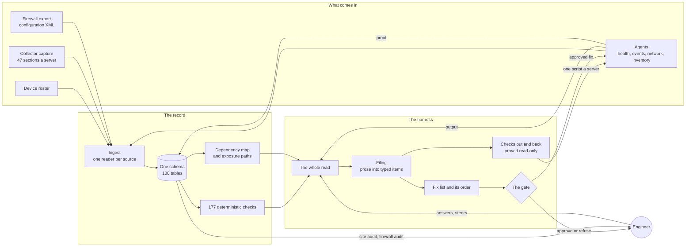
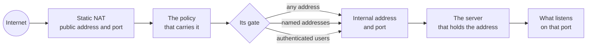
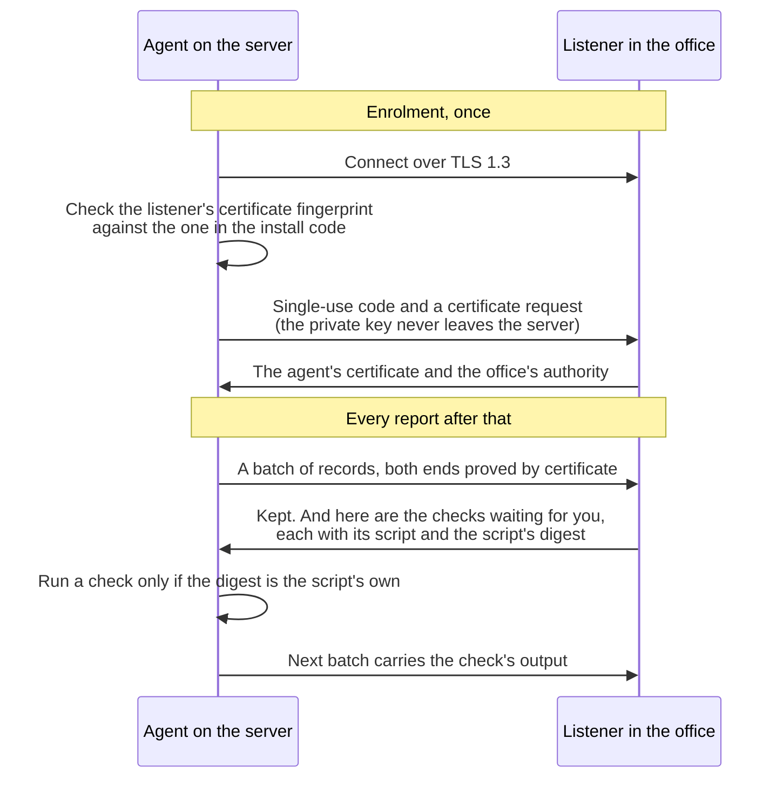
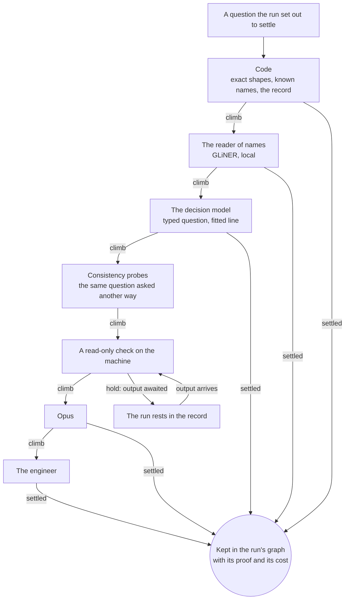
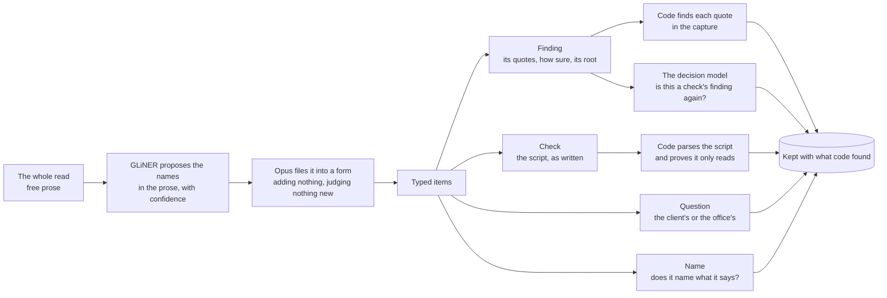

# NinjaToolKit v9

**A model reads the whole server. Code holds it to the evidence. An engineer decides every change.**

A technical case study of NinjaToolKit v9.0.1, released 19 November 2026.

**Author:** Ryan Haig, Forward Deployed Engineer and AI Automation Engineer. I designed the platform, built it and
released it.

**What this document is.** NinjaToolKit is private company software, so its source is not public. This case study
describes its architecture, its method and its measured behavior without reproducing source, and it contains no client
names, machine names, addresses or client data. Every worked example and every screen in the film runs on an estate that
does not exist: five invented clients, 31 invented servers and seven invented firewalls, generated for this purpose and
checked by script against the real estate's names so that nothing invented collides with anything real.

**How to read the figures.** Every figure is **measured**: the output of a command or a run, taken at the v9.0.1 tag
unless the sentence says otherwise. Where a figure comes from the estate the product was built against, it is a count
only. Where something is built and not yet proved in production, section 16 says so.

**The film.** The companion film is the released program itself working the invented estate, recorded as it happened:
[watch it online](https://ryanh-sudo.github.io/ninjatoolkit-case-study/film/).

---

## Contents

1. [At a glance](#1-at-a-glance)
2. [Summary](#2-summary)
3. [The problem, and the constraints that shaped the design](#3-the-problem-and-the-constraints-that-shaped-the-design)
4. [The system in one picture](#4-the-system-in-one-picture)
5. [Data engineering: an estate in one record](#5-data-engineering-an-estate-in-one-record)
6. [Deterministic first: the check catalogue](#6-deterministic-first-the-check-catalogue)
7. [The firewall pillar](#7-the-firewall-pillar)
8. [Agents and the standing watch](#8-agents-and-the-standing-watch)
9. [The harness](#9-the-harness)
10. [One loop, end to end: a worked run](#10-one-loop-end-to-end-a-worked-run)
11. [The operator's surface](#11-the-operators-surface)
12. [The audits: client deliverables from the same record](#12-the-audits-client-deliverables-from-the-same-record)
13. [Operating it](#13-operating-it)
14. [How it was proved](#14-how-it-was-proved)
15. [How it was built](#15-how-it-was-built)
16. [What is not proved yet](#16-what-is-not-proved-yet)
17. [Five disciplines, one system](#17-five-disciplines-one-system)
18. [Lessons](#18-lessons)
19. [Glossary](#19-glossary)

---

## 1. At a glance

| | |
|---|---|
| **What it is** | An audit and remediation platform for managed Windows Server estates and WatchGuard firewalls, used by a managed service provider's engineers. One self-contained Windows program on a server, used by the whole office, with its own agents on the servers it looks after. |
| **What it does** | Takes in a PowerShell collector's capture, firewall configuration exports and live telemetry. Judges all of it with deterministic checks. Lets a frontier model read each server whole, then holds everything the model said to the evidence in code. Carries each problem through read-only checks to a fix that waits at an engineer's gate and proves itself afterwards. Renders two client audits from the same record. |
| **Release** | v9.0.1, 19 November 2026, on v9.0.0 of the day before. v9 is a rebuild: nothing of the v8 code is left in the tree. |
| **Size** | 138,202 lines of Python in 606 files across eleven layers; 32,284 lines of JavaScript and 10,227 of CSS as files; a 4,165-line PowerShell collector. |
| **Tests** | 6,096 passing in 671 test files (117,381 lines), 17 standing verification harnesses, a five-part release gate, 16 invariants on the rendered product. |
| **Deterministic checks** | 177: 117 for servers in 18 families, 52 in the firewall engine in 14 families, 8 more on a Firebox's own settings, certificates and reach. Mapped to the 287 controls of NIST SP 800-53 Rev 5's Moderate baseline and, through NIST's own references, to the 106 subcategories of CSF 2.0. |
| **Models** | Claude Opus 5.5 for reasoning, with Opus 5 as the fallback when a request is declined. Claude Sonnet 5.5 only to describe, never to diagnose. GLiNER 2.5, a small local model, to read names out of free text on the server's own processor. A hosted calibrated decision model (TypeSafe's Jev) for typed questions with probabilities. |
| **Data** | One SQLite schema at version 79: 100 tables and 131 indexes in a built database. |
| **Operations proof** | Two hours forty minutes of load on one process: 80,161 requests, no error, 193 ms at the 95th percentile, memory flat. Fifty agents reporting for an hour: 650 batches in, 650 kept. The process killed in the middle of an ingest and of a model call: the record's own integrity check passed both times. |
| **AI proof** | On the release candidate, with the real model: a firewall audit and a 23-server site audit written whole, 318 of 318 fields kept by code's check of the model's words against the facts. Three numbers the model wrote that were not in the facts were refused by code and rewritten on a second asking. |
| **History** | 6,526 commits since 6 March 2026; 62 version tags; 111 numbered design decisions; 38 research files. |
| **Built against** | A real estate of 234 rostered servers under 48 client organizations, 189 of them captured, and 54 configuration exports from 37 firewalls. Counts only appear here. |

---

## 2. Summary

**The bottom line.** NinjaToolKit v9 puts a frontier model to work on production infrastructure without trusting a word
it says. The model reads a server's entire raw output in one call and reasons freely. Nothing in the product acts on
that prose. A second pass files it into typed items, and code checks each one against the record: every quoted line is
found in the capture, every script is parsed and proved to only read, every fix carries its own proof and its way back
and waits for a named engineer. The result is a system that keeps the model's range and removes its authority.

**Why that order matters.** The first v9 design did the opposite. It filtered a server's evidence through checks and
small models first, and sent the frontier model only what was left. Then I measured it. One read of one server's
entire output, 2,424 records and about 224,000 tokens with no checklist in front of it, named a root cause and an order
of work that 176 deterministic checks and twenty model reads of the parts had not. All 18 of the records it quoted were
real. The design was turned around on that measurement: **the model reads everything first, and code supports the read;
code never narrows it.**

**What v9 adds over the shipped v8 line:**

- **Agents.** A small agent on each server reports health, events, the network and an inventory, and runs read-only
  checks it is handed. It calls out over TLS 1.3 and holds the line open. Nothing listens at a client.
- **A standing watch.** The product learns what each server looks like when it is fine, measures which fields move by
  themselves, and reads only what deviates. A reading that leaves its baseline, or servers that go silent together,
  open a Job without anyone pressing anything.
- **One loop.** Read the server whole, file what the read found, send its checks, read again when they return, order
  the fixes, write one fix whole, gate it, run it, prove it, watch it. The same loop serves one server and a fleet.
- **Both audits written by the model and checked by code.** The model is given an audit's facts and nothing else, and
  every name and number in its prose is checked against those facts before a client sees it.
- **A real operating envelope.** Sign-in by name, roles, two-person approval where an office wants it, nightly backups
  with a second location, a support file an engineer can send, and every model call priced before it is sent and written
  to a ledger.

**How I know it works.** Section 14 has the full account. The short version: the suite, the harnesses and the gate are
green on the release commit; the program was soaked, loaded, killed mid-write and walked from an empty folder at four
screen widths; and the evening v9.0.0 was released I ran it end to end with the real model on the invented estate.
That run, and the filming that followed it, found four defects no test had caught. They were fixed, each with a test
that fails on v9.0.0, and shipped as v9.0.1 the next morning. A release process that finds its own defects within
hours is the point of having one.

---

## 3. The problem, and the constraints that shaped the design

### 3.1 The work as it is actually done

A managed service provider looks after other companies' servers and firewalls. The engineering work has a shape that
any senior engineer will recognize:

1. Something is wrong, or might be. An alert fired, a user complained, or an audit is due.
2. The engineer collects evidence: a script run through the remote monitoring tool, a configuration export, an event
   log.
3. They read it. This is where the skill is: knowing that a clock seven minutes ahead on a branch domain controller
   explains the Kerberos errors on the file server next to it, and that the Group Policy failures are the same fault a
   third time.
4. They write the next script to confirm it, run it, read the result, and repeat until the cause is settled.
5. They make one change, prove it worked, write down how to undo it, and write it up for the client.

Steps 2 to 5 are where a model can help, and where an unsupervised model is dangerous. I had already been doing this
work by hand with a frontier model in a chat window: paste the whole output in, ask what is wrong, take its script, run
it, paste the result back. It worked well. It also depended entirely on me noticing when the model was wrong, and it
left nothing behind: no record, no audit trail, no second engineer able to pick up where I stopped.

NinjaToolKit is that loop turned into a product, with the judgment that used to live in my head moved into code.

### 3.2 The constraints

Each of these came from the people who would use it, and each one removed easy options.

| Constraint | What it forced |
|---|---|
| **It must run as one self-contained program.** No cloud service to stand up, no dependency to install, nothing fetched at run time. | A single-folder build with everything inside it, including a local model. A check at build time proves the program opens nothing outside its own folder and its data folder. |
| **Client data is confidential.** | A name map that replaces every client, machine, domain and user name with a stable stand-in before text goes to any hosted model outside the primary provider. Web search is off per question and never sees a capture. Credentials are scrubbed from every string bound for a log or a page. |
| **No change to a client's server without a named engineer's approval.** | Every fix waits at a gate. The gate is a table in code, never a question put to a model. An office can require two engineers. Changes through agents are off until the office turns them on. |
| **Nothing may listen on a client's network.** | The agent only calls out. Work for it rides back on the answer to its own report. |
| **The engineer is the customer.** They are busy, skeptical, and will stop using anything that wastes their time or lies to them once. | One act per screen. Every finding names its entity and the lines it rests on. "Cannot be determined" is a legal answer and is never drawn as a pass. Nothing explains the platform to the person using it. |
| **Money is real.** | Every model call is priced before it is sent, held under a ceiling of $3.00 a question and $8.00 a run, and recorded. The AI is off in a new install. Background work spends nothing until a budget is set. |
| **The tool must be honest about its own instrument.** | Absence is never rendered as zero. A count read from an event log that only holds a few hours says so. A finding that disappears is never called fixed unless a remediation is recorded against it. |

### 3.3 Four invariants

These hold on every surface and every report, and tests enforce them.

1. **Evidence first.** A screen or a report renders named entities; counts are derived on top of them and every count
   opens its list.
2. **Comprehensiveness.** A firewall audit is everything behind the firewall. There is no "top ten".
3. **Granularity preserved.** Every field the collector captures survives ingest, storage, judgment and rendering.
4. **A commercial boundary.** A client-facing document carries no pricing or cost content.

---

## 4. The system in one picture

**Reading the picture.** Four kinds of input land in one record through one reader each. Deterministic checks judge
everything first, at no cost. The model then reads each server whole, with the checks' findings beside it as context
and never as a filter. Filing turns the read's prose into typed items that code can verify. Verified checks go to the
server and their output comes back to a second read. Findings are placed into a kept list of fixes, the list is ordered
the way an engineer would work it, and one fix at a time is written whole and brought to a person. An approved fix runs
through the same agent, and its proof is a measurement taken later from outside the change.

### 4.1 Eleven layers, imports one way

The program is one Python package in eleven layers. An import may go down the list or stay inside its own layer. It may
never go up, and never round in a cycle. A test reads the import graph on every run and refuses a violation.

| Layer | Lines | What it owns |
|---|---:|---|
| web | 35,785 | The application server, the pages, the WebSocket hub, the agents' listener, sign-in |
| operate | 11,085 | What drives the work: the loop, the watch, the gate inbox, the fix lists, backups, the support file |
| audits | 7,113 | The record rendered as the site audit and the firewall audit |
| ai | 14,604 | The one model client, the harness engine, the whole read, filing, the decision model, the reader of names |
| remediate | 4,182 | Scripts and run tokens, the read-only proof, the gate hook, fixes and their way back |
| judge | 29,692 | The check catalogue, the firewall engine, exposure paths, compliance, the watch's rules, the dependency map |
| ingest | 17,354 | One reader per source: the roster, the capture, the firewall export, agent batches |
| domain | 2,555 | The models: estate, observation, finding, Job, fix, audit. Pure data, no I/O |
| store | 11,392 | The one connection factory, the writer, the schema, one repository per aggregate |
| core | 1,968 | Configuration, paths, the clock, typed errors, logging, the scheduler, the certificate authority |
| agent | 2,440 | The agent's own build. It may import only core and domain |

Two layers deserve a note. **`operate`** exists because the AI layer and the remediation layer may not import each other:
something above both has to drive a loop that reads, then acts. **`agent`** is deliberately starved of imports so that
the program installed on a client's server shares nothing with the office application except the record contract.

Structure is held by ratchets, not by intention. A test counts database connections opened outside the store, model
SDK imports outside the one client, threads started outside the scheduler, environment reads outside configuration,
script blobs inside Python strings, files over 1,000 lines and functions over 150. Each count may fall and may never
rise. At v9.0.1 the largest module is 999 lines.

### 4.2 The runtime

| Part | Choice | Why |
|---|---|---|
| Application server | Quart on Hypercorn, asynchronous | Streams and WebSockets without blocking; one process serves the whole office |
| Live updates | One WebSocket per browser, topics subscribed over it | A page is told of a change in the time the write takes, never on a timer |
| Database | SQLite in write-ahead mode, one writer, short writes | One file to back up; no server to administer; measured adequate for fifty engineers at once |
| Agents' listener | A separate TLS 1.3 server on its own port | It must read each connection's client certificate, and it must never be the console |
| Local model | GLiNER 2.5 in its own process on its own Python, spoken to over standard input and output | It opens no port; it is started on first use and stopped when idle so its memory goes back to the server |
| Packaging | One folder: the program, its libraries, the local model, the install script | "Self-contained" means the code: nothing is fetched or read from outside the folder |
| Background work | One scheduler with four lanes (section 9.2) | An engineer's request never waits behind background work |

---

## 5. Data engineering: an estate in one record

Everything downstream is only as good as the record. Most of the engineering effort in this layer went into four
things: reading messy operational inputs exactly, deciding who is who without guessing, keeping history so that "gone"
is never mistaken for "fixed", and making concurrent use by a whole office safe on one file.

### 5.1 Four sources, one reader each

| Source | What it is | What reading it takes |
|---|---|---|
| **The device roster** | A spreadsheet export from the remote monitoring tool: every device, its client, its site, its type | It goes in first. A server capture saves nothing until a roster exists to place it under |
| **The collector capture** | The text output of a 4,165-line PowerShell collector, 47 numbered sections a server, any number of servers in one file | Split by machine, then by section, then parsed section by section into typed fields |
| **The firewall export** | A WatchGuard configuration saved as XML | Read into one firewall model (section 7); the product was built against 54 exports of 37 devices |
| **Agent batches** | Typed records from the agent on each server, on a cadence | Checked against a shared record contract line by line; replays are harmless |

The application seeds nothing. A new install shows empty screens, each saying the one next step, and every figure it
ever shows was brought in through one of these four doors.

### 5.2 The capture: from a wall of text to a server's record

A fleet run through the monitoring tool returns one paste holding every machine's console output under a header line
of its own. The splitter recognizes that wrapper, strips it, and keeps each machine's header, site and run status for
ingest. Each machine's block is then cut into its 47 sections and each section goes to its own parser: identity,
hardware, storage, the operating system, roles, Active Directory, DNS, DHCP, file services, IIS, SQL Server, Exchange,
Hyper-V, installed software, services, the network, security settings, scheduled tasks, backup, event logs,
permissions, certificates, Group Policy, encryption, protocols, processes, and the rest.

Three decisions here pay off everywhere else:

- **The raw text is kept beside the parse.** The parse serves the checks and the pages. The raw text is what the model
  reads, exactly as it came (section 9.4).
- **A stored parse carries the fingerprint of the parser that made it.** When the parser changes, a stored parse made
  by older code is parsed again on first use. Nobody re-ingests, and no page ever mixes two parsers' ideas of a server.
- **Each server is saved in its own short write as it is read.** A capture of an entire fleet appears on the pages
  server by server while the drop is still being read, and no other engineer waits behind it. The drop is a batch with
  a state of its own (open, grouping, done, refused, interrupted), so a process that stops mid-drop says exactly what
  landed.

Agents and the newer collector emit **typed records** instead of text: one JSON record a line under a fixed envelope
(schema, run, token, host, sequence number, section, kind). A run is whole only when it has a begin record, an end
record whose count matches, and no gap in the numbering. A run that is not whole is kept and says why; it is never
silently treated as complete. A bridge writes a typed run back out in the text collector's own layout, so every parser,
check, page and audit works on both shapes.

### 5.3 Who is who

A server goes by several names: the roster's device name, the capture's upper-case host name, its fully qualified
name, and its 15-character NetBIOS name. The matcher places each one under its client from evidence, rung by rung, and
records which rung placed it and on what evidence. Where the evidence ends, or points at two clients, it places
nothing and asks an engineer once; the answer is kept and never asked again.

Two rules in this matcher were learned from measurements, and both are refusals:

- **An address never places anything.** Private address ranges repeat across clients. Measured against the real
  estate: joining firewalls to clients by subnet split on 32 of 37 exports and named the wrong client on 6. Joining by
  directory domain placed 13, and all 13 were right.
- **A firewall is never linked to a client by a guess.** An export's file name is whatever an engineer typed. A
  firewall belongs to the client an engineer links it to, and until then its audit names no server.

### 5.4 The record

One SQLite schema, at version 79, builds every database: 100 tables and 131 indexes once the telemetry tables are in
place. New tables are declared `STRICT`. A later change is a numbered step that is forward-only, transactional and safe
to run twice. A data folder from an older major version is refused with a plain sentence, not migrated by hope.

| Property | How it is held |
|---|---|
| **One way in** | Every connection comes from one factory. A test refuses a database connection opened anywhere else in the code |
| **Readers cannot write** | A read-only connection is opened in SQLite's own read-only mode, so a page that only reads cannot write even by accident |
| **Short writes** | One write is `BEGIN IMMEDIATE`, the statements, `COMMIT`. Nothing slow (a model call, a parse, the network) is ever inside one |
| **Attribution** | Every append is stamped with the engineer acting in that request, by a trigger, so no code path can forget |
| **No lost updates** | A single value (a note, a setting, a finding's state) is saved only if the row is still at the version the engineer's page read. Otherwise the page is told who changed it and asks which to keep |
| **One actor per action** | Starting a diagnosis, an audit, a fix approval or a wave takes a lease. A second engineer pressing the same thing is told who started it and when, instead of starting it twice |
| **Tell, do not poll** | Every commit says what it changed; pages showing it are told over their socket at once |
| **An append-only work log** | Every Job's events are appended, never edited. A Job is read from its events; it has no table of its own to drift |

**Findings have identity and history.** A finding is the same finding next time by what it is about, never by its
position in a list or by a model's wording. When a new capture is laid over the last one, each finding is opened, seen
again, or gone, and a finding that is gone is classified by why it is gone. The word "closed" is refused for anything
no remediation is recorded against. This one rule is what lets the product claim a fix worked: the claim rests on a
recorded change and a later measurement, never on an absence.

### 5.5 The dependency map and the seams

Two derived structures turn a list of servers into an estate.

**The dependency map** records what each server leans on, and each link carries its evidence: the domain controllers
of its domain (from a captured controller's own directory), the DNS servers its adapters ask, its DHCP server, its
Hyper-V host, the file servers it holds open connections to, its network on the client's linked firewalls, and its
backup server. An address resolves to a server only when a captured server of the same client holds it. Where the
records end, the link says so with the reason.

**The seams** are where one client's facts disagree across its servers. Every fact several servers hold about the same
thing is lined up: an address and who holds it, what each DNS server answers for a name, each server's time source,
its gateways, a Group Policy's version as each controller sees it, where each virtual machine runs. Where two sides
disagree, the seam keeps both and where each came from. No rule names a problem here. A seam is a disagreement to
explain, and it is some of the best material the model is ever given.

The instrument's own traps are checked before anything is marked: a MAC address is one value however it was written;
a MAC that one server sees at many addresses is a router's and places nothing; a policy version the collector could
not read is not a disagreement; a side with nothing captured is missing, never different.

### 5.6 Reference knowledge as dated data

Facts that go stale are data files, never code: the Windows Server, SQL Server and Exchange lifecycles with each
Extended Security Update year, firmware release dates, the snapshot of known-exploited vulnerabilities, Microsoft's
security baseline (361 settings, each with its expected value by server role), NIST's control catalogue and the CSF
core. Each file carries where every fact was read, the date it was read, and a stated life in days. A file read longer
ago than its life fails the test suite and the build, so the source is fetched again before the product can ship.

---

## 6. Deterministic first: the check catalogue

A model should never be asked a question that code can answer exactly. Before any model call, 177 deterministic checks
judge every server and every firewall. They cost nothing, they run in under a second a server, and they are the floor
the product stands on with the AI switched off.

### 6.1 One contract for every check

Every check, whether it reads a disk's free space or a domain's delegation settings, takes the same shape. It declares
what it reads, when it does not apply and why, and it answers with exactly one of four outcomes:

| Outcome | Meaning |
|---|---|
| **A fault** | Something is wrong, with the exact values it decided on |
| **Healthy** | Checked, and fine. A legal answer, shown as one |
| **Cannot be determined** | The capture does not hold what would decide it. Said with what would. Never scored as a pass |
| **Not applicable** | The subject is not the kind of thing this check judges, with the reason |

A fault also carries the conditions that would make it acceptable, each phrased as a question for the client. "This
share grants Everyone full control" is a fault; "it is a scanner drop that holds nothing for more than an hour" is a
condition that an answer can cross off. This is how an engineer teaches a junior to read a finding, and it is what
stops a tool from crying wolf.

Every check ships with labelled examples and must pass a proof of its own contract before it may join the catalogue.

### 6.2 The server checks

117 checks in 18 families:

| Family | Checks | Examples of what it decides |
|---|---:|---|
| Identity | 12 | Domain administrators past a sane count, kerberoastable service accounts, unconstrained delegation beyond the controllers, LDAP signing not required, replication failing from a partner |
| Updates | 10 | A reboot flag that survived a restart, an operating system past extended support or inside an Extended Security Update year, patching stalled |
| Hardening | 10 | WinRM accepting Basic authentication, a wildcard trusted-hosts list, legacy protocols and their cryptography |
| Roles | 10 | Hyper-V replicas set to start with the host, checkpoints left behind, a DHCP scope nearly out of addresses, a failover relationship out of its normal state |
| The fault library | 9 | Signatures generalized from real engagements: a clock with no reliable source, a domain controller on its hypervisor's time |
| Directory | 8 | The Kerberos service account without modern keys, a controller's address outside every directory subnet |
| Engagement checks | 8 | Scheduled tasks that restart a server outside the patch policy, the task that keeps an admin account locking out |
| Proven misses | 8 | Facts the open read and the catalogue had both missed on two real sites: a policy object linked nowhere, a privileged account whose password never expires |
| Network and Group Policy | 7 | A controller that lists only itself for DNS, default routes to two gateways |
| Storage | 6 | A volume under 10% free, a role that should not share a volume with the operating system, backup absent |
| Listeners | 6 | Remote Desktop with Network Level Authentication off, the host firewall off on the profile a domain server uses |
| Operations | 6 | One source flooding the system log, memory past 85%, a role installed and started for nothing |
| Network | 5 | A domain machine asking a public resolver, an adapter on a link-local address |
| Microsoft's baseline | 4 | The 361 baseline settings grouped the way the work is done: audit policy, user rights, security options, services |
| Protection | 3 | Nothing providing real-time protection (Defender standing down for another product is not the finding) |
| Shares | 2 | Everyone or Authenticated Users with full control after both the share and the file-system layers |
| Exposure | 2 | What the internet actually reaches on this server, from the one exposure path (section 7.4) |
| Event logs | 1 | A log too small to hold the week the other checks read |

Three of those families are worth a second look because of where they came from. The fault library, the engagement
checks and the proven misses are not textbook rules. They are signatures taken from real diagnostic work, generalized
to the deciding test, the value that marks the fault and what fixes it. Each carries the signature it came from. When
the model finds something no check raises, the product can turn that finding into a new check, confirmed by an
engineer before it joins the floor (section 9.13). The catalogue grows from the work.

### 6.3 Instrument honesty

A check that counts events is only as good as the log it counts from. On the real estate, the Security log held less
than the seven-day window the checks read on 95 of 179 servers, and less than a single day on 43, some of them only
minutes, because a 20 MB log was being filled by object-access auditing. A count read from such a log is a floor, and
a zero is not a quiet week. So one check names every log that is too small, and every check that counts from a log
says how much of the window that log actually held.

The same discipline applies to the agent. An event a server does not audit is reported as "not audited here", never as
zero, because the agent sends each server's effective audit policy with its counts.

### 6.4 One change fixes many servers

Findings are not work. Changes are. Measured on the estate: 2,116 findings on 189 servers came from 54 distinct checks,
and 91% of them from 35 checks that each fired on 20 servers or more. A **pattern** is one client's servers carrying
one check's finding where the change that closes it is made once for all of them: one Group Policy, one policy in the
endpoint product's console, one script. The product groups them, diagnoses the pattern once, and confirms each server
from its own evidence. Where every server shares one cause, code alone settles it, at no cost.

### 6.5 Compliance, control by control

Findings map to NIST SP 800-53 Rev 5's Moderate baseline, 287 controls, read from NIST's own machine-readable
catalogue. Every control is in exactly one of four states:

| State | Meaning |
|---|---|
| **Assessed** | Evidence fails it. Named with the servers or firewalls it fails on |
| **Partly assessed** | What was checked passed. The control's procedures, and the systems outside the capture, were not checked. A pass is never stated as the whole control |
| **Needs the client's evidence** | Nothing collected decides it. Stated with the question to ask |
| **Not applicable** | Only where evidence shows its subject is absent |

NIST CSF 2.0's 106 subcategories follow from the same controls through the references NIST itself publishes. Because
an informative reference is a related control and not the outcome itself, a subcategory reached only through one is
never called assessed. A scanner that reports "94% compliant" from configuration alone is overclaiming, and an auditor
will know it. This one does not.

---

## 7. The firewall pillar

The firewall half of the product is a network engineering tool in its own right. It reads a WatchGuard Firebox's
configuration export and answers the questions an engineer would spend a day answering by hand in Policy Manager:
what does this box let in, from whom, to which machine, and does anything actually answer there?

### 7.1 One model, read twice

The export is read into one firewall model: the device, its interfaces, address groups and aliases, services, policies
in their order, static and dynamic NAT, IKE gateways and tunnels, Mobile VPN, users, authentication domains and
licences. Lists keep the export's order. An absent value is absent, never a made-up default.

Every later judge, page and audit reads that one model, so the screen and the client's audit cannot disagree about a
number. Two independent readers fill it, and a standing test holds them in agreement over every export the product
was built against. A ledger lists every element path those exports contain, so an export that carries a path nobody
has read is named instead of silently skipped.

Small things matter in this parser, and each one below was a real defect before it was a rule:

- **A policy's number is Policy Manager's number.** On the real exports, 1,428 of 1,505 policies sit at a different
  place in the file than the number Policy Manager shows, by 1 to 10, because the file also counts the Firebox's own
  hidden policies. An engineer told to edit "policy 14" must land on the right one, so the product carries Policy
  Manager's number and never the file position.
- **VPN cryptography is not where it looks.** Phase 2 lives in sibling elements that name the IKE policy they serve.
  A proposal with a self-describing name states its algorithms; a hand-named one is decoded from its numeric fields.
- **Where an address leads is judged from the box's own interfaces, never from how the address looks.** A
  public-looking network that sits on a trusted interface is inside. A branch tunnel is a branch, never the internet.

### 7.2 The checks

52 checks in the engine, in 14 families, plus eight more on the Firebox itself:

| Family | Checks | What it asks |
|---|---:|---|
| Access | 8 | How the box is reached and administered: credentials pasted into descriptions, integration secrets stored in the export (named and fingerprinted, never printed), SNMP v1 or v2c, default community strings |
| Services | 7 | The subscription services: intrusion prevention on and updating, gateway antivirus, sandboxing, botnet detection |
| Traffic | 5 | What the traffic log says beside the configuration: flows after hours, one source carrying most of the bytes, volume that reads as exfiltration |
| Device | 4 | Firmware in a range listed as exploited in the wild, a cluster whose members drift, BGP neighbors without filters |
| Hygiene | 4 | Firmware behind its own release line, test rules left enabled, aliases no policy uses, local account sprawl |
| Inspection | 4 | Outbound rules that reach an encrypted DNS resolver, HTTPS inspection absent, HTTP/3 allowed around an inspected TCP 443 |
| Remote access | 3 | SSL VPN gateways with over-broad routes or no client certificate, a clientless portal publishing internal applications |
| Exposure | 3 | Services reachable from the internet, any-service allows, dangerous ports open inbound or outbound |
| Coverage | 3 | Whether the controls a rule should carry are on it: logging, intrusion prevention, a proxy where a packet filter passes an inspectable port |
| Perimeter | 3 | Anti-spoofing, IPv6 left open, who can reach the firewall's own management |
| VPN | 2 | IKEv1 tunnels, tunnels open to any peer, the weakest transform a peer may negotiate |
| Threats | 2 | Command-and-control beaconing and lateral movement, from the logs |
| Precedence | 2 | Rules that never fire because an earlier rule matches first |
| NAT | 2 | Static NAT that translates into a dangerous internal service, including a forward from one port to another |
| The Firebox's own settings | 6 | What the security services do once they are on: a threat level allowed through, a fast-scan mode |
| Certificates | 1 | The Firebox's own certificates judged at the date the configuration was saved |
| Reach | 1 | What an inbound allow for service "Any" actually reaches |

The last line has a story. The dangerous-ports check reads a policy's named ports. An inbound policy that somebody
later widened to service "Any" therefore dropped out of it, on 20 of the 53 exports then in hand: the widest rules
were the ones the check could not see. The answer key found the gap, and a check now says for each such policy, by
name, where it lets the internet in. That is what an answer key is for.

### 7.3 Posture a reader can explain

Every firewall check belongs to one of five domains: what answers the internet (Exposure), who gets in and how
(Access), what the Firebox looks inside (Inspection), the tunnels (VPN), and keeping the box (Operations). A rule that
fired costs its points in its domain. A domain scores 100 less its points. **The posture is the worst domain**, which
tells the reader why in one word. Only faults count: an affirmed control, an undetermined answer and a not-applicable
one cost nothing. Each finding also carries its MITRE ATT&CK technique and tactic, with revoked techniques mapped to
the ones that replaced them.

### 7.4 Exposure is a path, not a port

This is the pillar's center. A port scan tells you a port is open. An engineer needs to know what the open port
reaches.

A path runs from the internet through a firewall's static NAT and the policy that carries it, past its gate, to an
internal address and port, and on to the audited server that holds that address and whatever listens there. The
firewall's half comes from the rule base. The server's half comes from the captures. The join is computed once, and
the Paths page, the server's page, the firewall's page and both audits all read the same rows.

The gate is decided by the policy's weakest source member: a policy that names a user group beside "any external
address" admits anyone. Every path ends in one of six states:

| State | Meaning |
|---|---|
| **Live** | A server at that address listens on that port |
| **Not listening** | The server is there, its capture lists its listeners, and none is on that port. The route publishes nothing that answers: an orphan to remove |
| **Listeners not collected** | The server is there; its capture holds no listener table |
| **Ambiguous** | More than one of the client's servers holds the address. Kept as ambiguous, never resolved to a guess |
| **No host** | None of the client's audited servers holds the address |
| **Elsewhere** | Only another client's server holds the address |

That last state exists because of a real false alarm. Matching by address alone once reported a domain controller
published to the internet. The controller belonged to a different client that happened to use the same private range.
The join is now constrained by client, and the near miss is kept and shown as exactly that.

A second step follows each live path: what the exposed host may reach next, from the rule base's allow rules between
zones. That is what turns "port 3389 is open" into "the internet reaches a session host that can reach the domain
controller", which is the sentence that gets a change approved.

### 7.5 Reading a rule base the way a policy analyser does

The rule base page names five kinds of anomaly, pair by pair: a **shadowed** rule (an earlier rule takes all of its
traffic and acts differently, so it never fires), a **redundant** one (an earlier rule takes all of it and acts the
same), a **generalization** (a later, broader rule acts differently, so the narrow one is an exception above it:
usually meant, reported for reading), a **correlation** (two rules that act differently each take part of the other's
traffic, so their order decides), and a **consolidation** (two rules that could be one).

The comparison is made on the address space each side resolves to, the user groups that confine it, the interfaces an
"any" is held to and the rules' schedules. It is never made on alias names, because this vendor names every policy's
aliases after the policy, so names almost never match. A claim is made only where both rules' coverage is proved; an
unresolved side is no claim. The analyser under-reports and never invents. One reading was tried and thrown out on
measurement: treating two policies that differ only in service as a consolidation named 196 pairs across 37 exports,
a fifth of some rule bases, and not one was a finding. On this platform a policy is one policy type, so that is simply
how a rule base is written.

### 7.6 Tunnels, certificates and firmware

Each tunnel's cryptography is graded from the weakest Phase 1 transform and Phase 2 proposal a peer may negotiate. The
Firebox's own certificates are judged at the date the configuration was saved, since an expired web-server certificate
is what breaks the management page and the SSL VPN portal for users. Firmware is compared against the newest build on
its own release line and against a bundled snapshot of vulnerabilities known to be exploited, and the finding says how
old that snapshot is.

### 7.7 From a finding to a change made by hand

A firewall's fixes are never pushed. An engineer makes them in Policy Manager or the Web UI, and the product's job is
to make that safe and provable:

- **A firewall Job** is written from the engine's findings on the stored configuration: one issue per change.
- **Each written step names only what the firmware has.** Menu paths in a step are looked up in a vocabulary read
  from the vendor's own documentation, so a step never sends an engineer to a menu that does not exist.
- **The proof is the next export.** After the change, the engineer saves the configuration again and drops it in.
  "What changed" compares the two models and shows the before and after; the finding is closed by that evidence.
- **Complaints are worked by code first.** A site blocked, an inside service unreachable, a branch tunnel down,
  remote users dropping: each family's first checks read what is already held (the model, the rule base, the logs)
  before any model is asked, and a tunnel is diagnosed from both ends when both Fireboxes are in the record.

### 7.8 Linking the two pillars

When an engineer links a firewall to its client, the two halves of the product join. The firewall's ways in gain the
servers behind them. A server's page shows what the internet reaches on it. The site audit's network chapter draws
the firewall's routes onto the servers' network. And a check on the server side reads the same exposure rows, so a
server with Remote Desktop published to any address is a finding on the server, on the firewall, and on the path
between them, counted once.

---

## 8. Agents and the standing watch

A capture is a photograph. An estate needs a pulse. v9 adds a small agent on each server and a standing watch in the
office that reads what the agents send. This section is systems administration and security engineering: a program
that runs as SYSTEM on a client's server has to be boring, careful and impossible to turn against its host.

### 8.1 The agent

The agent is its own build, with its own small code base, installed as a scheduled task under SYSTEM. Its design is a
list of things it does not do:

- **It starts no other process to take a reading.** Health, events, the network and the inventory are read through the
  Windows API directly: processor time, memory, disks, services and their start types, a pending reboot, the event log
  API, the audit policy API. There is no PowerShell child for an endpoint protection product to stop, and no command
  line to tamper with.
- **It never reads an event's text or a secret.** Events are counted exactly, by log, provider, event ID and level,
  with the first and last time of each.
- **It listens on nothing.**
- **It never adds to a host's trouble.** When the processor was busy at the last reading, the heavier reads wait.

| Reading | Cadence | Notes |
|---|---|---|
| Health | Every 5 minutes | Processor, memory, fixed disks, uptime, automatic services not running, a pending reboot |
| Events | Every 10 minutes, each log | Window after window with no gap, from where the last one ended |
| Network | Hourly | Addresses, DNS servers, TCP listeners |
| Inventory | Daily | Operating system and build, domain, hardware, installed software, plus 30 further reads the text collector cannot take: disk provisioning, a volume's dirty bit, adapter settings and more |

Records are held on disk until the office confirms it has them. Each batch is one file, written whole under a
temporary name and then renamed, so a power cut never leaves half a batch. Batches go oldest first. One the office
refuses is set aside with the reason and never blocks the ones behind it. Through a long outage the queue keeps its
newest data up to a size limit and counts what it dropped.

### 8.2 The line

The office application runs its own small certificate authority. The install code an engineer downloads for a client
carries the SHA-256 fingerprint of the listener's certificate. The agent connects, checks that fingerprint before it
says anything, and only then sends its single-use code and a certificate request made with a key generated on that
server. From then on, both ends prove themselves on every connection. An agent is known by the fingerprint of its
certificate, and a revoked one is refused at the next request.

The listener is a separate server on its own port. It is never the console, and it answers exactly three things: an
enrolment, a batch of records, and a ping. **Work for an agent travels on the answer to its own report.** The agent
calls out, keeps the line open, and asks again shortly while a check is on its way. Nothing at a client's site ever
accepts a connection, so there is nothing there to scan, and no inbound rule to ask a client's firewall for.

The listener also defends itself: a rate limit by address, a bounded worker pool, and one short write a batch. Fifty
agents reporting for an hour put 650 batches in and 650 readings were kept.

### 8.3 Rules, alerts and Jobs

Only deterministic rules raise alerts. Each rule reads one server's recent readings, its event windows, how long a
reboot has waited and when its agent last reported. It says what is wrong in the server's own figures and what an
engineer does first. A rule that cannot be judged from what has arrived stays quiet instead of guessing. One alert is
kept per server and condition: opened when it first holds, kept current while it holds, closed after a quiet hour.

Between an alert and a Job sit layers that keep the noise out, cheapest first:

1. **Code, free.** An alert that fired just after its server restarted is held and read again once the server has
   settled, because a symptom that only follows a restart is not a fault. One that keeps firing joins the Job it
   already opened.
2. **Grouping by evidence.** Servers that go silent together are one problem, and one Job: three branch servers
   dropping off at the same minute is a link or a host, not three incidents. A problem joins another server's only
   through an edge of the dependency map.
3. **The decision model, only inside a budget.** A condition known to be harmless on a server like this one is kept
   and said, never opened, and only when the model's answer is inside its fitted bound.
4. **A nightly review.** A rule that fired repeatedly and was held or judged harmless every time is proposed for
   quieting on that one server, for an engineer to confirm.

What is still new opens a Job in its client's work, with its issues written by code. Its diagnosis starts by itself
only while that client has budget left for a whole run. With no budget set, the Job waits for an engineer.

### 8.4 The watch: learning what "fine" looks like

The hard problem in watching a fleet is that almost everything differs between two looks at the same healthy server:
process IDs, counters, memory figures, last-run times. Read naively, every server is always changing. The usual answer
is a hand-written list of fields to ignore. That list is never finished and is wrong on the next product a client
installs.

The watch measures instead.

**Which fields move by themselves.** The product takes pairs of captures of the same server, matches each record with
itself, and records which fields differed together. A field is called *moving* when it differed often enough to say
anything, it takes many values across the fleet (a field with few values is a state, and a service that keeps stopping
is a finding however often it flips), and when it differed it mostly differed alone. A field that changes together
with the rest of its record is the record changing. A moving number whose changes are mostly small is a level, and the
band it drifts within is kept: an event counted ten times more often than usual has left its band, and that is a
change.

**The instrument's own shifts.** A time that moved by the same amount on many records of one capture is the
collector's doing (a daylight-saving change moves every timestamp by an hour), and is read as unmoved. A time that
moved by anything else is a real change: someone edited a Group Policy.

**Which kinds are streams.** A kind of record most of whose keys were not there at the last look (recent events,
short-lived ports) is a stream, where a new record is the kind doing what it does.

**What many servers say alike.** A record's *form* is what it says with its moving values set aside. Across the real
fleet, only three records in ten are distinct. One look at a form can serve every server that carries it, though being
common is never a verdict: every server of a client can carry the same fault.

With those measured, every record of a new capture is given one standing:

| Standing | Meaning | What happens |
|---|---|---|
| **Deviates** | It was accepted in one form and now stands in another | Read first |
| **Changed** | Never accepted, and it differs from the last look in something that does not move by itself | Read |
| **New** | Not there at the last look (or *flow*, when its kind is a stream) | Read, unless it is a stream doing what streams do |
| **Unread** | The same as before, and nothing has ever looked at it | Left for the digest |
| **Rests** | Accepted, and it still stands as accepted | Taken out of the work, while it holds |
| **Gone** | The last look held it and this capture does not | Explained, never assumed fixed |

Two properties of this table carry the design. **Only "rests" leaves the work, and only while it holds.** And **not
having changed is never acceptance**: a record nobody ever looked at stays unread however long it has stood. The
baseline never narrows what can be found. It only stops the same settled thing from being graded again every night,
and it makes a change in a record nothing ever flagged stand out.

Measured on the estate, this funnel drops 92% of records between two captures of the same server before any model
sees them, and loses none of them: every record stays in the capture, on the map and in every whole read.

### 8.5 A round of the watch

For a client the watch is switched on for, inside that client's daily budget:

1. **A look at each server that moved.** What deviates, changed, is new or is gone is woven into small groups of
   records that are provably about the same thing (a service named in an event's message; two records naming the same
   other machine). The decision model grades every line, a dozen at a time: fault, routine or unclear. The large model
   then reads what climbs, the server's changes whole, because changes that arrive together usually have one cause.
   The small model earns its seat here slowly, and on purpose. Measured: asked to grade records that no reader had
   seen, 7 of its 40 most confident "routine" answers were faults. So until an office's own labels fit a line for
   this question, its answers are recorded and everything still climbs. It works in shadow, and the frontier model's
   reading is its teacher.
2. **The digest of what nothing has looked at.** After a first read, about 85 records in 100 had still been looked at
   by nothing. The digest works through them by form, so the same words are never put to a model twice.

A look is finished only when every part of it was settled. A look that was cut short, or whose model did not answer,
leaves the server exactly as it was: everything that moved is still moved at the next round. A finding lands on its
server; a line found fine is accepted on that server; a question only a person can answer is asked once and its answer
is kept as a fact about the client.

The watch is asked for, client by client. No client is watched until an engineer turns it on, because its first round
reads everything that client's servers hold and spends against that client's budget.

### 8.6 Proof after a change, and the daily clean read

A fix's own script checks itself just after it runs. That is not the proof. The proof comes later and from outside the
change: the fix's fingerprint, a read-only test that is true while the problem exists, is run again on the server
through its agent once the change has settled; and the record's watch on the findings that fix settles is compared
against untouched servers that hold the same finding over the same window. The control group shows that the reading
still sees the condition where nothing was changed. Both hold, and the fix is verified with its before and after kept.
Either fails, and the fix has failed: a reversible fix has its way back sent the same way the fix went, and anything
else asks an engineer.

Once a day, outside a client's quiet hours, each server with an agent gets one read-only sweep of the fingerprint of
every fix applied there recently. A clean result is kept as a clean day. This is how an experienced engineer closes an
engagement, by re-running the consolidated sweep until it reads clean, made continuous.

---

## 9. The harness

The harness is everything between a model and the world: what the model is shown, how it is asked, what is done with
its answer, what it may cause, what it costs, and how the whole thing gets better with use. It is the part of this
product I would defend line by line, and the part most worth reading if you build with frontier models.

Its one rule: **a model's words are testimony, not instructions.** Nothing in the product executes, files, closes or
changes anything because a model said so. Every effect passes through code that checks the claim against evidence the
model did not write.

### 9.1 The measurement that turned the design around

The first v9 harness was a ladder I called the burn-down. Each question climbed from the cheapest rung that might
settle it to the most expensive: code, then a local reader of names, then a calibrated decision model, then a check on
the machine, then the frontier model, then the engineer. The frontier model saw only the residue. On a simulated
estate it was cheap and precise.

Then I replayed real diagnostic cases through it and compared it with how I actually work a server with a model at my
desk: one conversation, the whole output pasted in, a best guess every turn.

| | The ladder (frontier model last) | The desk loop (frontier model first) |
|---|---|---|
| Named the right cause, or part of it, on 50 scored cases | 24 | 40 |
| Policy on uncertainty | Name a cause only when sure | Give a best read every turn and say how settled it is |
| "Settled" wrong | n/a | 1 time in 30 |
| Cost | baseline | about half |

The ladder had been muzzling the model. Asking it to speak only when certain made it silent exactly where a hypothesis
was most useful. And filtering its input through checks meant it never saw the two unrelated-looking lines, 1,900
records apart, that together named the root.

The measurement that settled it: one read of one real server's entire raw output, 2,424 records and about 224,000
tokens, with no form to fill and no checklist. It named a root cause and an order of work that 176 deterministic
checks and twenty reads of the parts had not. Every one of the 18 records it quoted was real.

So the design was inverted, and the ladder was kept for what it is good at. **The frontier model reads everything
first. Code and the small models then do what they are measurably right at: verifying, placing, grading and
remembering.** The engine that climbs rungs is still the engine. What changed is which questions are put to it.

### 9.2 The engine: runs, questions and rungs

Every unit of AI work is a **run**: a server's whole read, its filing, a watch round, a firewall's diagnosis, an
audit's prose, a console turn, a fix being written. A run sets out to settle **questions**. Each question climbs
**rungs**, cheapest first, and a rung says exactly one of three things:

| Answer | Meaning |
|---|---|
| **Settled** | Here is the answer, its confidence and its proof |
| **Climb** | I cannot settle it; here is what I learned; the next rung should try |
| **Hold** | I am waiting for something outside the run: a check's output, or the engineer. Named |

**Every try is kept as a node in a graph**: what it read, what it said, its proof, its confidence, what it cost and how
long it took, and the facts it produced, linked to the question, to the try below it and to the causes its claims bear
on. That graph is the run's audit trail. It is also what the engine page draws, and what the learning loop measures
each rung's accuracy from.

**The engine holds nothing between calls.** A run is read back from its record every time it advances. So a run whose
process died half way resumes where it was, with whatever was in flight marked as interrupted and tried again. A run
waiting on a check's output simply goes on when the output is in. And no database write is ever held open while a
rung works. This is what made "kill the process in the middle of a model call" a test that passes.

**Before any rung that spends,** the engine asks the AI switches (the office, the function, the client) and the
ceilings: $3.00 a question, $8.00 a run. A rung that is refused is recorded as skipped, with the reason, and the
question climbs past it, ending with the engineer when nothing else may try.

**One door for all of it.** Every piece of AI work waits at one scheduler with four lanes:

| Lane | What runs in it |
|---|---|
| **Engineer** | What a person started: a read, a console turn, an audit. Never behind background work, never counted against it |
| **Gate** | What follows an engineer's answer: a check that came back, a fix to prove |
| **Watch** | The standing watch over a client's fleet |
| **Nightly** | Reviews, the fix list, the office's standard |

The three background lanes share a fixed number of slots, earlier lanes first, and at most a set number run at once
for any one client, so one busy client never starves the rest. That is the difference between an AI feature and an AI
service several people can use at the same time.

### 9.3 One client for every model call

There is exactly one place in the program that calls a Claude model, and a test refuses a second. Every call through
it:

- **Is refused at once while the AI switch is off.** The switch is read on every call, and a missing or unreadable
  setting reads as off. It fails closed.
- **Is priced before it is sent.** Its worst case is logged as sent, and what it actually cost, cache reads and writes
  included, is logged as done and written to a ledger row beside the log line, so the database and the log always hold
  the same calls at the same prices. If the database is busy the row is retried in the background: an early version
  lost 9 of 178 rows to a locked database, and a ledger that drops rows is worse than none.
- **Streams when it is long.** A long call once sent whole was dropped and silently sent again by the SDK: 508 seconds
  across two attempts, the first never recorded. Long calls now stream, which also lets an engineer stop one.
- **Uses adaptive thinking**, bounded by an effort setting, which is what current models accept.
- **Is resent once on the fallback model when the primary declines it,** with both calls billed and later calls of
  that kind routed to the fallback first. A request is never reworded to slip past a refusal.
- **Is cut cleanly by a Stop,** keeping what arrived, and is stopped by code if the reply starts repeating one short
  piece to its end.
- **Raises only typed errors,** scrubbed of any credential, each a kind and one plain sentence an engineer can read.

Evidence that many calls share is sent as a cached prefix. Questions about one server arrive minutes apart, which is
the gap an hour-long cache pays for.

### 9.4 The whole read

The model is given a server's entire collector output, exactly as it came, in plain words, with no form to fill and
nothing filtered or judged by code in front of it, and room to think. Beside it: what the office and the client have
said, what the checks already raise, and what the model itself wrote last time.

It says what the server really is, what is wrong with it by root and symptom in order, what it would do about each,
what it would check next (as the read-only PowerShell itself), what only a person can answer, and what is fine.
Findings are numbered, so a later look speaks of the same finding by its number.

Two things about how it is asked matter more than any clever prompt:

- **It is talked to like a colleague who has just been handed the folder.** It is told where it is, whose estate this
  is, how the data arrived and what the work is aiming for. The more a prompt reads like a form, the more the answer
  reads like one.
- **It is told it is in a loop.** Its checks will run and come back. A check that code can prove read-only runs by
  itself. Every change waits for an engineer. A reader that knows it will get another look gives its best read instead
  of hedging everything into uselessness.

The same step runs one level up: the model's own write-ups of each of a client's servers are read across, for what no
single server shows and for the order to work in.

### 9.5 Filing: the bridge from prose to the record

A whole read is free reasoning in the model's own words. There are no code words in it and no hidden markers. So how
does a paragraph become work? By a second, deliberately dull run called filing.

1. **The local model proposes** the things the prose names: machines, accounts, services, products. It settles
   nothing. Its proposals climb with the question.
2. **The frontier model files** its own write-up into a form, adding nothing and judging nothing new: every finding
   with the records it quotes, how sure it said it was, and the finding it names as its root; every check as written;
   every question and whose it is to answer; and a verdict on each name the local model proposed. So the small model's
   guesses reach the large one with their likelihood, and the large one's verdict becomes the small one's training
   label.
3. **Code checks what was filed, by reading and never by words.** Each quoted record is looked for in the capture the
   read was made from. Each script is parsed and proved to only read, or the reasons it does not are kept beside it.
4. **The decision model is asked one typed question per finding:** is this the same problem a deterministic check
   already raised on this server? Its answer is used only where it clears its fitted line (section 9.9).

**Nothing is dropped for failing a check.** An item is kept with what code found, so a finding whose records were not
found is shown as exactly that, and never as proven.

#### Finding a quote is harder than it sounds

On four real reads, an exact text search found 191 of 376 quoted records. Yet every one of 18 quotes checked by hand
was true. The model writes a record the way a person would in a note, not as the row stands in the file. A matcher
that only does exact search would have thrown away half of a correct read. A matcher that is too loose would "find"
anything. So a quote is looked for four ways, strictest first:

1. Word for word, in a line of the capture as it came.
2. As the row itself: the quote is a set of name and value pairs equal to a record's own.
3. By its names and values: every name-like word of the quote sits in one record, with most of its numbers.
4. The same, across one set of records of the same section and kind, when no single record holds them all.

What comes back is the record's place, how it was found, and **on how many records it was found**, so a quote that
fits hundreds of rows is known to pin nothing. A quote too thin to place is not found, by rule.

### 9.6 Landing

Landing takes each filed finding up into the record once, by code and on typed fields only:

- A finding that stands on records code found becomes a finding of the record, keyed by the record it stands on. From
  then on "its evidence still stands" is checked against the next capture like any other finding's.
- A finding the read itself said is what a deterministic check already flags is not a second finding. Its records are
  kept as showing that check's.
- A finding with no record pinned is kept as said, with why. It waits for a check to show it, and opens nothing.

Every item's place is recorded in both directions, so landing a read twice changes nothing. Idempotence is not a
nicety here: reads are retried, processes restart, and a duplicated finding is a lie in a client's report.

### 9.7 Checks out and back

The read wrote the checks it would run next. Each must now cross three controls before it touches a server.

**The read-only proof.** A script runs by itself only when code proves, by parsing it, that it reads and changes
nothing. First an allow-list analysis of what the script does. Then PowerShell's own parser is run over the block:
every command with its arguments, every method call with its type, every property that is set, every type named, an
exit, a redirection, each judged against the same allow lists. A block the parser cannot be run on is not a read. The
proof fails closed.

About one check in ten that the model writes is refused, nearly always for the same few reasons: a vendor's own
executable, a fetch from the network, a construct the proof cannot see through. A refused check is shown once more to
the model that wrote it, with code's reasons. What it writes back is proved exactly as the first was. Proven, it takes
the check's place. Not proven, the check waits for an engineer as it was first written, with both reasons. A check is
rewritten once only.

**One script per server.** The proven checks of a server's read are joined into one script, each between its own two
marks, with a failure of one printed as a line and never stopping the rest. The joined script is proved again as it
will run, and a check whose addition breaks the proof is left out.

**The gate hook.** Every action the model proposes passes one hook before anything happens. It is code in the path,
never a tool the model could decide not to call, and the model's reasoning never reaches it: the hook sees only what
the action is and does. In order:

1. **Code's hard rules, never overruled.** The script passed its checks. It touches only the machines its step asked
   about. Every line it quotes stands in the evidence it was shown. A fix always asks a person.
2. **The client's setting.** An office can set any client so that checks wait for one press.
3. **A second opinion** from the decision model: is the action about the Job's step, is it grounded, does it touch
   anything unasked. Any doubt asks the engineer. A second opinion that is set up and does not answer also asks the
   engineer. It is never the only control and never the reason an action runs.

The verdict is run (read-only only), hold (one press by an engineer), or refuse, each with why and by whom.

Where an agent reports from the server, the script runs through it. Where none does, it becomes one card for that
server: the engineer copies it, runs it through the remote monitoring tool, and pastes the output back. The product
works the same with no agents at all.

What comes back is cut at the marks and read beside each check it answers. If a script was cut short, the checks it
never reached go out again by themselves. That last sentence is one of the four defects v9.0.1 fixed (section 14.5).

### 9.8 The second look, and questions that become facts

The second look is the same conversation picked back up: the output whole again, the model's own last write-up, what
each check returned, the answers people gave, and where each finding stands now. It is the same step an engineer takes
when a script's output comes back, and it is where hypotheses become settled or get dropped. A second look may quote
what its checks printed, and code looks for those quotes in the checks' output and records which check printed each.

A read asks two kinds of question, and the product treats them differently:

- **What only the client can answer** (is this account still used, when is the maintenance window) becomes a question
  for the client. Its answer is a fact about that client, read into every later call for that client.
- **What is the provider's own to answer** (is this remote tool ours, how do we patch) is true for every client. It is
  asked once, kept once, and read into every later call for any client.

Nothing an engineer has said is ever asked again.

### 9.9 The fix list, and a small model made honest

**Work units that hold still.** Asked to group findings into work, a frontier model gives a slightly different
grouping every time: of pairs it ever put together, it kept only 53% to 87% together across runs. That is useless for
tracking work. So the model writes each client's catalogue of fixes once, each fix one change done once with what it
changes and what it prevents, and every finding is then *placed* into the one fix that clears it, or none. On
placement the same model agrees with itself 97.5% to 100% of the time. "None" grows the catalogue.

**Placement is the small model's seat.** Each new finding is offered the six fixes nearest its words, and the
calibrated decision model chooses. That is cheaper and faster than a frontier call, and it is only acceptable because
of what stands between its answer and any use of it.

The decision model ranks well and reads wrong. Measured: answers it stated as 91.4% sure were right 76.1% of the time.
Thresholds set by eye on such numbers missed their own risk targets by 7.5 to 12.5 points. So its confidence is never
used raw:

1. **Recalibration.** Per question, on labelled answers, by isotonic regression: a monotone map from what it says to
   how often it is right.
2. **Acceptance within a stated error bound.** An answer is accepted only at or above the lowest calibrated
   confidence at which a one-sided Clopper-Pearson bound on the error rate of the labelled answers above it stays
   under the action's limit. Candidate thresholds are tested from the most confident down, stopping at the first that
   fails, so the bound holds as stated without a correction for multiple testing. In practice: with no errors
   observed, 59 labels are needed to bound error at 5%, and 149 to bound it at 2%. An action that touches a server
   gets a smaller limit than a note.
3. **Consistency probes.** A choice asked again with its options reversed, a yes asked as its negation, a question
   asked again in other words, all in the same request. When a probe disagrees, the answer climbs whatever its
   confidence.
4. **A shadow week.** A new threshold decides nothing for its first seven days. Every answer in that week is recorded
   beside what actually happened.
5. **A pinned version.** Thresholds are fitted to one model version. A request names that version exactly, and an
   answer from any other version is refused, not used.

Anything below the line climbs to the frontier model, whose placement becomes the label that fits next week's line.
Until an office has enough labels of its own, every placement is the frontier model's. And one rule is written on
purpose: an engineer's own placement is never moved by a model.

**What the decision model is never asked.** To count, to read a date or a time window, to read a hex code, or to make
the decision itself. It answers narrow typed questions (18 in the catalogue, plus three batteries) as a choice among
named options, a score on a ladder, or yes or no with a probability. The model judges; code decides.

**The line.** A client's open fixes are then ordered the way an engineer would work them: the root before its
symptoms; shared foundations before what leans on them (time, then DNS, then Kerberos and the directory, then logons,
because Kerberos needs time and names and every logon needs Kerberos); a server others lean on before the servers that
lean on it; read-only and reversible before risky; one change per server at a time; identical fixes grouped behind one
gate with the first server as the canary.

### 9.10 A fix, written whole

A fix is written only when what it would settle is settled, and code decides that on typed fields, never on words.
Then the frontier model writes it whole:

| Part | What it is |
|---|---|
| **The pre-check** | A read-only test that is true while the problem exists. It is the problem's fingerprint, run first to confirm the change is still needed, and run again afterwards as proof |
| **The change** | What to change and where, as a script with its guards: the right machine, a dry run by default |
| **The proof** | What output shows it worked |
| **The way back** | How to undo it |

Replayed against 72 past diagnoses, the model wrote the engineer's own fix, or part of it, 86% of the time, and every
one came with a pre-check, a proof and a way back.

Two further properties are worth stating plainly.

**"No change worth making" is a good answer.** The model decides first whether a change is worth making at all. If
not, the fix is kept as left, with who it rests with and why, and nothing waits at a gate. In the worked run, the
watch declined to write a fix that would have set DNS to secure updates before the time fault was repaired, with the
reason that doing so in that order would cause an outage. A system that can decline is a system you can leave running.

**The gate is a person.** The fix waits on a page that shows its four parts, with Approve and Not now. An office can
require two engineers. With "changes to servers" off, which is the default, an approved fix is handed to the engineer
with its script to run. With it on, the approved script goes to that server's agent with its digest, the agent runs it
only if the digest matches, and a client's fixes go in waves: the canary first, each next server only after the one
before came back healthy, one fix per client out at a time, nothing during quiet hours. A result that is not healthy
stops that client's wave until an engineer takes it up. An engineer can grant a class of reversible fix leave to run
alone for one client; a risky fix, or one made by hand, always waits.

Then the proof of section 8.6: a measurement taken later, from outside the change, against a control.

### 9.11 The reader of names

Free text is full of things worth extracting: a host nobody has recorded, an account, a service, a product. The
approach is code first and a small local model second.

Code reads everything that has an exact shape, exactly: IP addresses, Windows error codes, security identifiers, UNC
and registry paths, URLs, accounts. It also reads every name the record already knows wherever it stands as a whole
token. Measured on 61 real engineering texts, hosts and services read this way came back at 100% precision with every
known one found. A known name that is also a common word (a machine called DNS) is held, because code cannot tell it
from the word.

GLiNER 2.5 reads what has no shape. It runs in its own process, below normal priority, with no window and no port, on
the server's own processor, so nothing leaves the building. Its raw spans are weak: host precision was 6% to 7%
zero-shot on those same texts. So a span from it is never acted on. It proposes; the frontier model confirms during
filing; and each confirmation is a label. On one real filing it proposed 60 names and the frontier model held 8 of
them as right, which is exactly why it proposes and does not decide. Every week the trust given to it, per kind of name, is fitted again from
those labels.

Using a weak model honestly is a design skill. The wrong conclusion from "7% precision" is to remove it. The right one
is to give it a seat where a wrong answer costs nothing and a right one saves a frontier call.

### 9.12 Talking to the work

The console is how an engineer talks to a Job. A question is routed by code before any model sees it:

1. **A fact the record holds** (a server's last boot, its roles, a client's open Jobs, a firewall's firmware) is
   answered from the database, dated, with no model call. Facts from the record are exact.
2. **A concept** is described by the cheaper model, which is held to describing: no machine's evidence, no cause, no
   script. A cheaper model may describe and never diagnose.
3. **Anything else** is a turn of the frontier model on that Job, with the Job's history, the server's capture and a
   small set of tools.

Every line an answer quotes is checked, word for word, against what the turn was shown. An attached log is read by
code first: kept whole when it fits, otherwise each repeated line kept once and counted, with the lines that matter
first. A steer typed while a check is out reaches the next look. Web search is off for every question until the
engineer turns it on for that one, and then it is its own call that sees only the question's words with every client,
machine and domain name replaced by a stand-in: no capture, no history, so no query can carry a name.

A Job's time entry, the client email and a remediation report are written from the Job's own record of facts, in the
office's own shapes, and nothing is sent from the application.

### 9.13 Checks the model writes

When a read finds something no deterministic check raises, the product can turn the finding into one. The model writes
it as a rule: one kind of record, conditions on its fields, the kind of machine it applies to, and a sentence to say.
The rule is **interpreted, never executed**: code evaluates the conditions against each server's parsed record. It is
kept only if it fires on the finding's own server. A silent rule is shown that server's rows once and repaired; one
still silent is dropped with the reason and never asked again. A rule that fires waits for an engineer to confirm it,
with every server it fires on listed, before it joins the floor. Absence is not a value: only "exists" may speak of a
field that is not there.

### 9.14 The audits' words

The site audit and the firewall audit are written by the model and are still safe to hand a client, because of one
arrangement: **the model is given the audit's facts and nothing else, and it never supplies a fact.**

Code lays out the whole audit first: every finding, table, figure and count. The model writes the prose that walks a
reader through it: the dominant risk, why each first action comes where it does, each chapter's takeaway, each
finding's claim. Then code reads every field before it is used. Each number, whether written in figures or in words,
each IP address and each quoted name must be in the facts. Nothing may name this application, an AI, or a framework
the audit does not judge. A field that fails is asked for once more with what was wrong. One that fails again is
dropped and the audit prints its own deterministic sentence in that place.

On the release candidate, with the real model: a firewall picked at random, 13 of 13 areas and 182 of 182 fields kept;
a 23-server fleet, 11 of 11 areas and 136 of 136 fields kept. On the way there, three numbers the model wrote that
were not in the facts were refused by code and rewritten on the second asking.

With the AI off, both audits still render complete, in code's own words. The model improves the reading; it is never
load-bearing.

### 9.15 Learning from the work

Nothing asks an engineer to grade anything. Labels come from what the work already leaves behind, read by code:

- A cause the loop confirmed is **right** when its fix proved: the issue closed as fixed, and every symptom that
  waited on it stayed quiet for the watch's period or was absent from a capture taken after the fix. It is **wrong**
  when an engineer closed the issue as "checked, not a problem", or the symptom came back.
- The frontier model's placement of a finding labels the decision model's placement of the same finding.
- The frontier model's verdict on a proposed name labels the local model's proposal.

Once a week, in code only, with no model call:

- Each decision-model question with enough two-sided labels has its threshold refitted, and only when the new fit
  rests on at least as many labels as the one in force, so a handful of labels never replaces a well-founded line.
- Each kind of run is measured from its graphs: which rung settled what, every answer whose outcome is known, with an
  error bound.
- Alarms are raised with their reasons: accepted answers wrong more often than the bound allows, the share accepted
  drifting, a new model version answering with no fit, settled causes wrong more often than the loop's own bar.
- A cause proved on three or more servers is proposed as a new check.

One figure should rise week on week: the share of questions settled below the frontier model. That is what "learning"
means here, with a number on it.

Accuracy is always three numbers, never one: **precision** (of the answers asserted and graded, the share right, with
an exact one-sided bound on the error rate so a high figure is never claimed from a handful), **coverage**, and
**cost**.

### 9.16 Privacy and untrusted input

- **A capture is untrusted input.** Share descriptions, account names and event text can carry instructions aimed at
  a model. The defense is structural: nothing acts on model prose, the gate hook never sees model reasoning, and every
  claim is checked against evidence the model did not write.
- **The name map.** For any hosted model outside the primary provider, code replaces every client, host, domain and
  user name with a typed, stable stand-in. The map is built from the office's own records, never discovered by a
  model, and nothing goes out while a leak check finds a known name in the text.
- **No person is named.** Product text and prompts say "the engineer". A capture's only trace of a person is an
  account, and the one shape that turns an account into a person is rewritten before the model sees it.
- **Credentials are scrubbed** from any string bound for a log, a page or a stored record. Keys are encrypted at rest
  and never returned once saved.
- **The local model stays local.** It opens no port and reads nothing but what it is handed.

### 9.17 What it costs

Measured on real runs, counts and money only:

| What | Measured cost |
|---|---|
| The deterministic checks, the exposure paths, compliance, the funnel | $0 |
| One whole read of a large server (224,423 tokens in, 56,536 out), live | $2.03 |
| The same kind of read sent as a half-price batch (three servers, 643,585 tokens in) | $0.97 a server |
| Those three servers' write-ups read across, for the fleet's causes and order | $1.45 |
| Filing one read into typed items | $0.39 on average |
| A client's fix catalogue written the first time (42 fixes, 312 findings placed) | $0.55 |
| A second look at a small server once its checks returned | $1.24 |
| One fix written whole | $0.04 to $0.12 |
| The decision model, 974 typed gradings | $0.04 in all |
| A full firewall audit's words and a 23-server site audit's words, together | $2.28 |
| Ceilings enforced in code | $3.00 a question, $8.00 a run |

A watch round that nobody is waiting on is sent as one batch at half price and answered within hours. Its parts are
recorded exactly as sent, so the answers are read against the lines that were asked and never against a later plan.

Every AI path was first proved against a local stand-in that speaks the provider's protocol and costs nothing. Real
spend came only after, in fifteen measured runs, each with its question and its scoring written down before it ran.
A run with no question it could change the answer to is not a run worth paying for.

---

## 10. One loop, end to end: a worked run

Everything in this section happened, on the released program, on the invented estate, and every figure is read from
that run's own record. Two records are used, and each step says which:

- **The clean run**, on the v9.0.1 build, over a fresh data folder.
- **The rehearsal**, earlier the same evening on v9.0.0, over the same estate. Its later steps (the second look and a
  fix through the gate) are shown from it because the clean run stopped at an honest boundary, described at step 6.

### Step 1. An estate lands (clean run)

An empty install. The office is named, an engineer picks a name, and three drops bring in the estate: a roster of 374
devices under five clients, one capture of 31 servers, and seven firewall exports. Twenty-two of the servers belong to
three clients that have agents; each enrolls with its own key and certificate and starts reporting.

Before any model is involved, the watch reads the agents' first readings and opens **eight Jobs on its own**: two
servers at the branch whose clocks are seven minutes off the application's, a file server at 2.9% free on C: and 4.7%
on D: with its shadow copies failing, and three servers that have waited eight days for a reboot. Nobody pressed
anything.

### Step 2. What code knows (clean run)

The 117 server checks and the firewall engine have already judged everything. On BR-DC01, the branch domain controller,
code raises seven findings: kerberoastable service accounts, LDAP signing not required, a DNS zone that accepts
unauthenticated updates, stale computer accounts, LLMNR still answering, TLS 1.0 and 1.1 on by the operating system's
default, and the operating system and directory sharing one volume. None of that is wrong. None of it explains why
Kerberos is failing at the branch.

### Step 3. The whole read (clean run)

The engineer opens the server's read view and presses "Read this server whole". The model receives the entire capture,
59,404 characters, with what the office has said and what the checks raise beside it.

It writes sixteen numbered findings, root first:

> **F1.** The clock of this DC is set wrong: it takes time from an outside source instead of the domain, and Kerberos
> is failing on skew.

followed by the replication and Netlogon failures that follow from it, a dead domain controller still registered in the
directory and in DNS, the unauthenticated zone, and twelve more. The read cost **$1.23**.

### Step 4. Filing (clean run)

The read is filed into typed items, for **$0.48**: 16 findings, 18 read-only checks, 15 questions and 60 names the
local model proposed. Code looks for every quoted record in the capture, parses each check and proves it reads and
changes nothing. The proven checks are joined into one script of 17,008 characters, eighteen checks each between its own
marks.

### Step 5. The gate holds, and a person presses (clean run)

The decision model, set up on this run, gives its second opinion on the joined script and reads part of it as not
grounded in the evidence. By the gate's table, any doubt asks the engineer. The script waits on Today as one card.

The engineer presses "Run it". The script is handed to BR-DC01's own agent in the answer to its next report.

On v9.0.0 that press failed. It was defect one of v9.0.1.

### Step 6. An honest boundary (clean run)

At this point I paused the work for an hour, and stopped the simulated fleet with it. When the fleet came back, the
server's answer arrived after its check had expired: a check not back within fifteen minutes expires, and the listener
refused the late answer, exactly as it should.

The engineer's next move would be to read the server whole again. That press was refused too, by the model provider:
the account's usage limit had been reached. The program said so in plain words and spent nothing.

Both refusals are the product doing its job. They are also why the next two steps come from the rehearsal.

### Step 7. The second look (rehearsal)

In the rehearsal, the same server's checks came back in time, and the engineer pressed "Look at it again". The model was
given the output whole again, its own last write-up, and what every check printed. That second look cost **$1.83** and
moved the cause one link up the chain:

> **F18.** The PDC has no time reference (settled).

The branch controller had been taking time from an outside source, which is wrong for a domain controller. But the
measurement the checks returned showed the bigger problem: the domain's primary controller, which every other machine
ultimately follows, took its time from its Hyper-V host rather than from any real reference. The engineer's question had
started as "why is this branch server seven minutes off?" and ended as "the whole domain's time is unanchored." That is
the kind of answer a part-by-part checklist does not reach, and it is the reason the design reads whole.

### Step 8. The fix list and its order (rehearsal)

The client's fix catalogue was written once, seventeen fixes, and 48 findings were placed into it. The decision model
was not yet fitted to this office, so every placement was the frontier model's. The planner put them in working order:
name resolution and time first, because Kerberos needs both and every logon needs Kerberos.

### Step 9. A fix, written whole, through the gate (rehearsal)

The standing watch, with a small daily budget, wrote the first fix on the line, for **$0.12**: on BR-FS01, remove the
public resolver 8.8.8.8 from the adapter's DNS servers and keep the domain controllers.

It came to the gate in four parts. Its test is true while the problem exists. Its change refuses to guess: before
touching anything it checks whether the setting comes from Group Policy or from DHCP, and if so it stops and says where
the real fix belongs. It backs up the exact current state for its way back. Its proof is the test run again.

An engineer approved it. With changes to servers allowed in Office, it went to BR-FS01's agent within a minute, ran, and
printed its proof. The fix is recorded as applied, with who approved it, and it stays "proving" on the fix list until
its fingerprint, run again later through the agent and compared with untouched servers, holds.

Then the watch's next round declined to write the next fix on the line, setting the DNS zone to secure-only updates,
and said why: doing that before the time fault is repaired would cause an outage. A system that can decline is a
system that can be left running.

### Step 10. The firewall (clean run)

VPC-HQ-FBX, the client's main Firebox: 22 findings, posture 41 of 100, weakest in Operations, Fireware one release
behind. Four ways in from the internet, all open to any address.

An engineer links the firewall to its client. Two of the four routes now reach a server that answers: port 443 on the
public address lands on the ERP web server, and port 33890 lands on Remote Desktop on the session host, open to anyone.
A firewall Job opens with one issue per change; code settles 22 of its 44 questions at once and the rest wait for
their proof, because firewall fixes are made by hand.

The fix is made in Policy Manager: the vendor's Remote Desktop rule and its NAT are removed, and that access moves
behind the SSL VPN. The new export is brought in. The firewall Job settles the fix from the export itself, and What
changed lays the two audits side by side: five findings gone, each classified by its cause, and four new.

### Step 11. The deliverables (clean run)

The site audit and the firewall audit are rendered from the same record. With the model unavailable, both still
render complete, in code's own words: the site audit's posture is 56 of 100, set by Network.

### What it cost

| Record | Calls | Spent |
|---|---:|---:|
| The clean run: one whole read, its filing, the fix list | 4 | $1.76 |
| The rehearsal: two whole reads, their filing, a second look, the fix list, two fixes written, small repairs | 12 | $6.27 |

Every call is in each run's own ledger. Every deterministic step, every proof, every page and both audits cost nothing.

---

## 11. The operator's surface

The best harness in the world fails if the engineer does not trust the screen. The console was designed against one
acceptance test, in an engineer's own words: could a colleague turn it on and know how to start working on servers
tomorrow, without being taught?

### 11.1 The pages

| Page | The one question it answers |
|---|---|
| **Today** | What needs me now? Decisions waiting, in the order the planner would work them, each with the evidence it rests on |
| **Work** | What is in motion? Every Job, and where it stands |
| **Estate** | How is everything? Every client and server, live from an agent or from a snapshot with its age |
| **A client** | A dashboard: its servers, findings and posture, its line of work, its watch |
| **A server** | What is wrong, the network, posture, identity, security, infrastructure, software, every captured field, and the whole read |
| **Firewalls, and a firewall** | Every Firebox by posture; one whole: its ways in, its rule base, its tunnels, its audit |
| **Paths** | Every route from the internet to something inside, worst first, each saying what closes it |
| **Fix lists** | Every finding placed in one fix; the fixes in working order |
| **Globals** | Problems with one origin across many clients, proposed by code and confirmed by an engineer |
| **Audits** | Both audits, each as a full audit and a Brief; what changed since the last |
| **The engine** | Every layer of the harness at work today: what each settled and what it cost |
| **Office** | Every setting in one place: the AI's switches, people, agents, keys, budgets, backups |

### 11.2 Design law

The console follows a written style law that a lint enforces, and the law is mostly a list of refusals:

- **No containers.** A section is one hairline, not a box. Decisions, issues, Jobs and fixes are rows, not cards.
- **State rides one edge.** A thin rule at the left: gold for a decision, a live color for an answer, the severity
  ramp for a finding. Never a fill.
- **One framed button per surface.** Everything else is a label. If every button is primary, none is.
- **Figures are written, not dialed.** "11 being worked and 23 proved this week", not a row of gauges.
- **Names, evidence and figures in a monospaced face; every other word in one sans-serif.** Nothing under 11 pixels.
- **Absence is said.** "Not determined", with the reason, never a zero and never a blank.
- **Never explain the platform to its operator.** A sentence that would still be true on a different product is cut.
  Every finding is the named entity, why it is true from its own evidence, and something to approve or open.

### 11.3 The machinery, drawn

Work pages stay calm. The machinery shows only in a small set of hand-drawn canvas visuals, and they obey one rule
that separates an instrument from decoration: **a visual moves only on a recorded event.** Nothing is animated for
show. Every moving mark is something that happened, and every fact in a picture is also in words beside it.

| Visual | Where | What it draws |
|---|---|---|
| **The loom** | Today | The last hour, from every client through code, the reader of names, the decision model and Opus to the engineer. Gold knots are decisions |
| **The wheel** | Estate | Clients round a ring, each server a column of rings by state, from noticed at the rim to proved at the center |
| **The rope** | A Job | Its evidence taken apart into lines by source, braided into one rope per issue; each pass of the loop pulls it tighter |
| **The engine** | The engine | The harness's layers stacked, questions climbing, the share each layer settled and its cost |
| **The seams** | A client | What leans on what: time, DNS, hosts, replication, policy, ways in. A disagreement burns |
| **Every way in** | A firewall | Internet, NAT, policy, gate, server, listener. A path with no gate burns until the next export closes it |
| **The Braid** | A fleet Job | Servers as rows on one clock: waves, health gates, the way back |

Color encodes where evidence came from (a snapshot, telemetry, a live check, another machine, a firewall export, an
engineer's words), and shape encodes who acted (code a square, the reader of names a hollow bead, the decision model a
diamond, Opus a ring, the engineer a gold knot), so identity never rests on color alone.

### 11.4 Fast, for many people at once

- A page's document holds no estate data. It is drawn once per page for the life of the process, kept compressed, and
  served from memory; fifty engineers opening the same page draw it once. Data arrives over the page's own socket.
- A database that cannot answer is an error with its reason. A page never quietly shows yesterday's data.
- Every list has the same keyboard: a command palette, jumps, filter, and a help sheet generated from the same table
  as the bindings, so a shortcut cannot be documented without working.
- Speed is a test, not a hope. In the built program: list pages 36 ms first and 27 ms on repeat; a click's feedback in
  31 ms; a server's first view 54 ms at the 95th percentile.

---

## 12. The audits: client deliverables from the same record

Two documents leave the building: the **Comprehensive Site Audit** of one client's servers and the **Comprehensive
Firewall Audit** of one Firebox. Each has a client's copy, an engineer's copy and a short Brief.

**One model, three copies.** An audit is a model of pure data made from the checks' answers. The copies render from
that model and read nothing else, so every number any copy prints is one the model holds, and a test fails on any
rendered number it does not. The screen that shows a firewall and the audit a client receives read the same views, so
they cannot disagree.

**Self-contained and designed for print.** Each copy is one HTML page with its styles, typefaces and drawings inline.
There is no script, so nothing on the page runs. Every figure is a drawing built from rows of facts: bars, heat
matrices, a support timeline, the network and its ways in, the dependency graph, the tunnel map.

**The site audit** runs eleven chapters and three appendices: an executive summary; the fleet and its dependencies;
directory and identity; security configuration; the network; continuity and backup; lifecycle and software;
compliance, control by control; modernization and AI readiness; patterns across the servers; and a roadmap in phases.
Appendix A is the register of every finding. Appendix B gives every server its own profile in nineteen parts, with the
capture's own rows whole: every certificate, every update, every share's grants. Appendix C says what the audit read
and did not, and how each number is counted.

**The firewall audit** runs thirteen chapters: an executive summary; scope and methodology; the network at a glance;
every way in; attack paths; who may reach whom; remote access and identity; the rule base; inspection and services;
the Firebox itself; what the traffic shows; compliance; and a roadmap. Its centerpiece is the pathways: every route
from the internet to the host that answers, and the two-step paths from an exposed host to what it can reach next.

Three rules keep them honest:

- **Every section is on a ledger.** When the audits were rebuilt in v9's engine, each section of the earlier reports
  became a ledger row, and a test holds the rendered audit to every one of them. Nothing was quietly dropped in a
  rewrite.
- **What a model found and no check holds is "probable".** It prints in the engineer's copy only. When an engineer
  has looked and agrees, they confirm it once, by the finding's identity, and from then on the client's copy carries
  it. A model never puts a finding in front of a client on its own word.
- **No commercial content.** No price, cost or return figure appears in any client-facing copy.

A second audit of the same device knows the first. Each finding carries an identity that survives between runs, so it
is matched to itself and not to its place in a list, and one that disappeared is classified by why.

---

## 13. Operating it

A tool an office depends on has to be installed, signed in to, backed up, monitored and supported by people who did
not write it. This section is the systems administration around the software.

### 13.1 Install

The release is one zip: the program's folder, its libraries, the local model and an install script. On a server:

1. Unzip it.
2. Run the install script as an administrator, or as SYSTEM from the remote monitoring tool. A `-Plan` switch prints
   what it would do and changes nothing.
3. The script puts the data folder under the machine's program-data directory, readable by SYSTEM and Administrators
   only; registers a task that runs the program as SYSTEM after every boot and restarts it if it stops; opens the
   host firewall for the console's port and the agents' port from private addresses only; starts the program; and says
   whether both ports answer. Everything it says is kept in a log beside the program.

Upgrading is: remove the task, replace the folder, run the script again. The data stays where it is.

**A start that fails still says why.** The application's log lives in its data folder. If that folder cannot be used,
the process would end before any log exists, and as a SYSTEM task it has no window to say so. So the entry point hands
a failed start to one file beside the program. Once software runs on someone else's server, the logs they can send you
are the only way you will ever read it.

### 13.2 People and access

- **Sign-in by name.** Each engineer has their own password, kept only as a PBKDF2 hash. A wrong name costs the same
  work as a wrong password. An account rests for five minutes after five wrong tries, and one address may try twenty
  times in five minutes.
- **Attribution everywhere.** Every write is stamped with the engineer who made it. Every approval is recorded with
  who gave it.
- **Two-person approval** where an office asks for it.
- **The AI's switches.** One master switch; under it, each AI function and each client. An engineer can hold one
  client's checks for a press, or turn the AI off for one client entirely. A setting that cannot be read is off.

### 13.3 Backup and recovery

Every client, capture, firewall, Job and its history live in one database file. A checked copy is made every night
with SQLite's online backup, each copy is opened and verified, and the newest ten are kept. Office can name a second
folder, on another disk or another machine, and proves it by copying the newest backup there at once. Restoring is
stopping the program, replacing one file and starting it again.

### 13.4 Support

When something goes wrong, an engineer saves a **support file** from Office: one zip with the log's last 5 MB, the
trail of screens that browser visited, the version and the machine, the agents' side of things, a failed start if
there was one, and the records of any Jobs the engineer ticks. Every secret the application holds is scrubbed from all
of it. The log, the screen trail and the model calls carry the same action ID, so the three line up into one story.

### 13.5 Measured under load

| Test | Result |
|---|---|
| Soak: one process, 2 hours 40 minutes | 80,161 requests, no error. 17 ms median, 193 ms at the 95th percentile. Memory 547 MB at the start, 643 MB at its highest, 617 MB at the end |
| Fifty agents reporting every five minutes for an hour | 650 batches accepted, none refused, 650 readings kept |
| 25 engineers at once | First visit 31 ms and repeat 7 ms at the 95th percentile |
| 50 engineers at once | First visit 29 ms and repeat 8 ms at the 95th percentile |
| The process killed mid-ingest, as a power cut would | The database's own integrity check passed; the batch said "interrupted"; warm again within 34 seconds |
| The process killed in the middle of a model call | The same; the read is shown as interrupted, and nothing is sent to the model again by itself |
| Nineteen pages at phone, tablet, laptop and desktop widths | No sideways scroll |
| First run from an empty folder | Answers two seconds after start; a first site audit open seven actions later |

These were measured on v9.0.0's release candidate. v9.0.1 changed four code paths, each walked in its own build.

---

## 14. How it was proved

### 14.1 Five kinds of evidence

| Evidence | What it is | At v9.0.1 |
|---|---|---|
| **The suite** | Tests by behavior, run in batches | 6,096 passed, 39 skipped, 0 failed, in 671 files |
| **Standing harnesses** | Scripts that prove specific past defects stay closed and that rendered output matches its evidence | 17 of 17 |
| **The release gate** | Five sub-gates that must all pass before a release may be cut | 5 of 5 |
| **Rendered invariants** | Properties of the built product's actual output | 16 of 16 |
| **The walk** | The built program, from an empty folder, with real mouse input, pictured and read | Done at v9.0.0; v9.0.1's fixes walked in its own build |

The harnesses exist because a green test suite has, in this project's own history, coexisted with wrong output. A
test asserts what its author thought to assert. A harness opens the rendered artifact and compares it with the
evidence. Both run; neither is trusted alone; and a person still looks at the screen.

### 14.2 Structure held by ratchets

Tests count things that should never grow: imports that go up the layers, database connections opened outside the
store, model calls outside the one client, threads outside the scheduler, scripts inside Python strings, files past
their ceiling, tests that read source text instead of exercising behavior. A count may fall. It may never rise. When
one falls, its baseline is lowered in the same commit. This is how a 138,000-line code base written quickly stays one
that can be changed.

A separate ledger lists 140 abilities, every capability of the previous major version and every layer of the harness
study, each with where it lives now and how it was proved. A test fails if a row's home disappears. The rebuild could
not lose a feature by accident.

### 14.3 An answer key written first

Accuracy claims rest on keys written before the thing being measured existed: labelled findings on real servers, and a
firewall key that found the "service Any" gap described in section 7.2. A path is scored as precision, coverage and
cost, with an exact bound on the error rate. Scoring patterns are written from the engineer's own words before a run,
and every hit and every miss is read by hand afterwards, because a pattern match is not a correct answer.

Failures are kept. The study that shaped the harness records five ideas that were tried and refuted, with their
numbers. A document that shows only its successes has hidden its method.

### 14.4 Real runs, each with its question

No model call was ever made "to see what happens". Each of the fifteen measured runs in the last phase had a written
question whose answer would change a decision, a spending cap, and its scoring written before it ran. Spend is read
from the ledger, never recalled. The runs that mattered most:

- **The whole read** (section 9.1), which inverted the design.
- **The loop, for real, through an agent on a real machine:** read, file, checks out through the agent, output back,
  second look, a fix at the gate.
- **The site audit's words on the real model.** It passed its scoring and still exposed two defects no stand-in run
  could have: a second asking that rewrote a cache, and checks placed in the wrong chapter. The model's own prose is
  what read wrong.
- **Both audits on the release candidate:** 318 of 318 fields kept.

### 14.5 v9.0.1: the release found its own defects

v9.0.0 was released on 18 November. That evening I ran the released build, end to end, with the real model, on the
invented estate built for the film: five clients, 31 servers, agents reporting. That run, and filming the fixed build
the next night, found four defects:

| Defect | Cause | Fix |
|---|---|---|
| A held check from a whole read could not be released. Pressing "Run it" on its card answered that the Job did not exist | Such a check hangs on a client's standing Job, and the route that takes the press only knew the other kind of Job. It only showed when a check was held: a client set to "checks wait for a press", or a decision model configured and not answering | The press is taken on the check itself. Pressed twice, or under the wrong Job, it is refused in words |
| When a script was cut short, the checks it never reached were never sent again | One call to a name that did not exist. The error was caught and logged, so the output that did return was kept and the rest silently never asked for | It opens the record through the connection's own file. The existing test had reached the behavior only through a different layer |
| The card for such a check said "The best read so far: True" | A flag was printed where a sentence was expected | The card says only what it knows |
| In Office, pressing any tab (AI, People, Agents, Data) did nothing, so an installer could not reach sign-in, the AI switch, the agents or the backups | A name declared for one switch inside the page's click handler hid the page's own function for opening a view, for every press | The switch's callback has its own name. A test runs the page's script and presses all nine views |

Each fix has a test that fails on v9.0.0. The suite, the harnesses and the gate ran again on the final commit, the
program was rebuilt from a clean export, and the fixes were walked in the built program: every Office tab pressed
with the mouse and drawn; a held check's press answered, the listener handed the check to that server's agent 0.3 seconds later, the card left Today, and a script
answered short had its missing check re-sent by itself with no error in the log.

One thing in the original plan was taken back before the build. I had listed a fourth item, a fault in splitting a
multi-server capture. It was not a product defect. The remote monitoring tool writes each machine's header in
capitals, the splitter correctly expects that, and my invented capture had written them in lower case. The generator
was wrong, the product was right, and saying so is part of the job.

The lesson is the one this whole document argues: tests, harnesses and a stand-in are necessary and not sufficient.
The defects lived in a path that only a real model, a real hold and a real agent exercise together.

---

## 15. How it was built

I built NinjaToolKit with Claude as an engineering partner, and the way that partnership is run is as much a part of
the work as the code. It is the same problem the product solves, pointed at software instead of servers: get a
frontier model to do a large volume of reliable work, and keep a person in control of everything that cannot be
undone.

**What I own.** The architecture, the domain judgment, the safety model and the invariants, and every decision that
cannot be reversed: a merge, a tag, a release, a change to a prompt, a paid call.

**The process.**

- **A plan before building.** Every phase starts as a written plan that I approve, with the effects an engineer will
  see named in advance. Work outside an approved plan does not happen.
- **A durable project record.** The position, my standing rulings and the design law live in the repository, not in a
  conversation, so decisions survive context limits and model changes. 111 numbered decisions; 38 research files.
- **Every outside fact is fetched again before it enters code.** A version, an API's shape, a limit or a price is
  read from its source on the day it is used, pinned, and the read is named in the commit.
- **Ledgers move in the same commit as the code.** A finding is marked fixed in the commit that fixes it. There is
  never a follow-up commit "for the record".
- **Done means walked.** A green test is not done. Done is the built program, from an empty folder, with real input,
  pictured, and the picture read.
- **Zero-cost AI testing first.** Every AI path is proved against a local stand-in before a real call is made, and no
  spend gate is ever proved by spending.
- **Human gates on irreversible actions.** A push to the release branch is refused by the repository itself; at a
  release I run that one command by hand.
- **Measured, never recalled.** Every number in a status report, a release note or this document is the output of a
  command run at the time.

**Why it matters for the work I do.** A forward deployed engineer's job is to take frontier models into a real
operating environment and make them produce reliable work there. This platform is that problem at small scale: an
environment with real constraints, real clients and real cost, where a model's output has to be held to evidence by
code, and a person has to stay in control of everything that touches production.

---

## 16. What is not proved yet

Stated here so nobody meets it as a surprise.

- **Agents over the internet.** They are built for it and proved on a local network with real and simulated agents.
  They are not yet proved from outside an office's network.
- **The standing watch on its own timer with real spend.** It has run on its own timer against the stand-in, and for
  real when pressed. It spends nothing until an office sets a background budget.
- **A client's first view** measures 142 to 203 ms at the 95th percentile against a 100 ms budget that was set before
  that page became a dashboard. The budget or the page will move; it is an open decision.
- **Partial abilities.** Of the 140 abilities on the ledger, 81 are recorded as running and 45 as partial, most of
  those waiting on a real export, a credential or a first real use.
- **Not in this version:** certificate renewal and re-keying from inside the product; single sign-on with multi-factor
  authentication; the firewall vendor's cloud API (its reader is built and has never run against a live account);
  a code-signed agent; VMware hosts.
- **Found while filming v9.0.1, not yet fixed:** after a second firewall audit, the What changed page kept showing its
  earlier state until the program was restarted. The comparison itself is right (it showed at once after a restart);
  the page's cache did not see the new audit. It is logged for the next release.
- **Firewall fixes are by hand, by design.** The product writes the steps and proves the result from the next export.
  It does not edit a firewall.

---

## 17. Five disciplines, one system

| Discipline | Where it shows in this system |
|---|---|
| **Data engineering** | Four source readers that emit one model. A text parser for 47 sections with a fingerprint that forces a re-parse when it changes. A typed record contract with completeness rules. Identity resolution by evidence with measured refusals. One strict schema with numbered forward-only steps. Findings with identity and history, where gone is never fixed. An append-only work log. Host-by-host short writes under concurrency. Reference data with provenance and a shelf life. |
| **Data analysis** | A measured funnel: which fields move by themselves, fitted from pairs of captures, not listed by hand. Forms counted across a fleet. Isotonic recalibration and exact binomial bounds for a small model's confidence. Precision, coverage and cost as three numbers with error bounds. Answer keys written first, scoring written before each run, and refuted ideas kept with their numbers. |
| **Forward deployed engineering** | A frontier model placed in a production loop with a harness around it: one client, priced calls, ceilings, a ledger, refusal handling, a scheduler with lanes, prose filed into typed items, quotes pinned to evidence, scripts proved read-only, a gate that is code. Built by sitting with the work as it is actually done, and inverted when a measurement said the first design was wrong. |
| **Network engineering** | A full firewall model from a configuration export. Exposure computed as a path from the internet through NAT and policy to a listening process, in six states. Zones judged from interfaces, never from names. Rule-base anomaly analysis on resolved address space. VPN cryptography graded. An agent protocol with a private certificate authority, mutual TLS 1.3, fingerprint pinning and outbound-only connections. |
| **Systems administration** | 117 server checks drawn from real diagnostic work across Active Directory, DNS, DHCP, Hyper-V, file services, patching, hardening and backup. A 4,165-line PowerShell collector. An agent that runs as SYSTEM, reads through the Windows API and starts no process. An install script with a dry run, a locked-down data folder, a boot task and scoped firewall rules. Nightly verified backups, a support bundle, and soak, load and kill tests. |

---

## 18. Lessons

1. **Let the strongest model see everything, and trust nothing it says.** Filtering a frontier model's input to save
   money made it worse at exactly the thing it is best at. The savings belong after the read, in verification and
   placement, where small models and code are measurably right.
2. **Free prose and typed records need a bridge, and the bridge should be boring.** Filing adds nothing and judges
   nothing. That is what makes everything after it checkable.
3. **A model that may only speak when certain goes quiet where a hypothesis is most valuable.** Ask for a best read
   every turn and a statement of how settled it is. Then let "settled" open a gate and "likely" produce the next check.
4. **A safety control must be in the path, not in the prompt.** The gate is a table in code. The model's reasoning
   never reaches it. Whether a person is asked is never a question put to a model.
5. **A small model's confidence is a ranking, not a probability.** Recalibrate it on labels, accept it only inside a
   stated error bound, run it in shadow first, pin its version, and let it climb when in doubt.
6. **Measure the instrument before you trust the reading.** An event log that holds four hours cannot tell you about
   a week. A field that always moves is not a change. A firewall address that looks public may be inside.
7. **Absence is not zero, and gone is not fixed.** Most false reassurance in operations tooling comes from breaking
   one of those two rules.
8. **Prove a fix from outside the fix.** A script that checks its own work proves that the script ran. The proof is a
   later measurement, by a different path, against servers nobody touched.
9. **Run the real thing, for real, before anyone else does.** Four defects survived 6,092 tests and were found in two
   evenings of using the product the way it is meant to be used.
10. **Make structure a ratchet.** Rules that live in a document decay. Rules that live in a test that may only count
    down do not.

---

## 19. Glossary

| Term | Meaning here |
|---|---|
| **Capture** | The text output of the PowerShell collector for one server: 47 sections |
| **Export** | A firewall's configuration saved as XML |
| **Record** | The product's database: everything brought in and everything decided, with history |
| **Check** | A deterministic rule with one contract and four possible outcomes |
| **Finding** | Something wrong, named, with its evidence and an identity that survives between captures |
| **Whole read** | A frontier model's reading of one server's entire capture |
| **Filing** | Turning a whole read's prose into typed items that code can verify |
| **Landing** | Taking verified items up into the record, once |
| **Read-only proof** | Code's demonstration, by parsing, that a script reads and changes nothing |
| **Gate** | A point where a named engineer must approve, answer or refuse |
| **Gate hook** | The code every proposed action passes before anything happens |
| **Fix** | One change, written whole: pre-check, change, proof, way back |
| **Fingerprint** | A fix's read-only pre-check: true while the problem exists |
| **The line** | A client's fixes in the order an engineer would work them |
| **Job** | The story of one stretch of work for one client |
| **Run** | One unit of AI work, kept as a graph of questions and the rungs that tried them |
| **Rung** | One way of settling a question, from code up to the engineer |
| **The watch** | The standing look at a client's fleet for what deviates from what was accepted |
| **Rests** | A record that was accepted and still stands as accepted |
| **Form** | What a record says with its moving values set aside |
| **Seam** | A fact that disagrees across a client's servers |
| **Path** | A route from the internet through NAT and a policy to a server and a listener |
| **Global** | A problem with one origin across many clients, confirmed by an engineer |
| **Stand-in** | A local service that speaks a model provider's protocol and costs nothing, used to prove AI paths |
