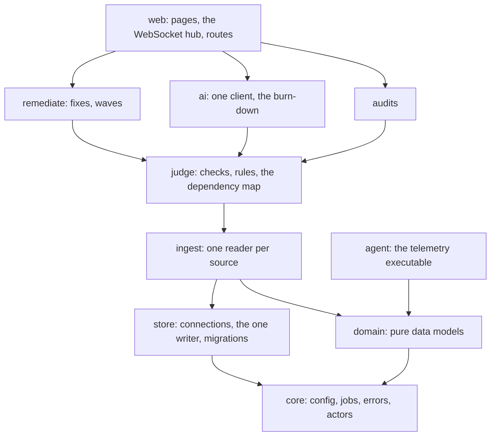
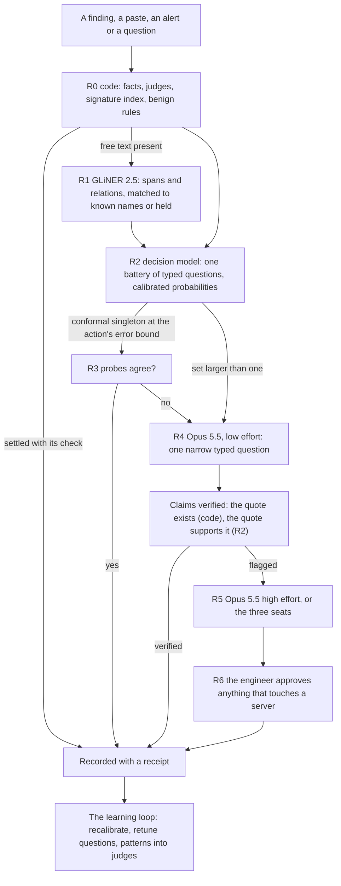
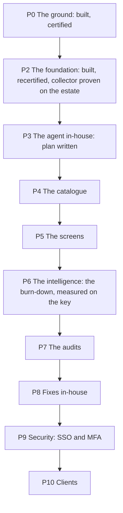

# NinjaToolKit v9: Evidence-First AI Diagnosis for Managed Infrastructure

**A technical case study of the next version, in build**

**Author:** Ryan Haig, Forward Deployed Engineer and AI Automation Engineer

**Subject:** NinjaToolKit v9, the successor to the shipped v8.3.1 (released October 17, 2026)

**Status, October 28, 2026:** in build. The ground (P0), the data foundation (P2), the telemetry agent (P3), the check
catalogue (P4) and the new screens (P5) are built and recertified on real data. The intelligence layer (P6) has its
engine built: one harness graph that a server's, a fleet's and a firewall's diagnosis and every alert run through, with
the calibrated decision model live and a learning loop in the background. Measured at no cost on a simulated estate built
from the engineer's own 19 placed cases (570 Jobs): precision **0.958**, coverage **0.930**, **$1.11 a Job** against $4.69
for v8.3.1's three seats, 46.7% of the work settled below Opus. The measured run on real labels comes next.

**How to read the figures:** every figure is labelled **measured** (the output of a command or a run, with its date),
**published** (a result from the research literature or a vendor's documentation, named), or **target** (an estimate
the design commits to measuring). Nothing in the design phases is presented as a result. The platform is private
company software; this document describes its design and behavior without reproducing its source, and it contains no
company names, client names, machine names or client data. Every example uses an invented company, Vantorre Precision.

---

## Contents

1. Summary
2. Where v8.3.1 left off
3. Design principles
4. Architecture
5. The data foundation: collector v6
6. From records to a model of the estate
7. The AI architecture: the burn-down
8. Rung by rung
9. Inside a Job: hypotheses, evidence and the next best check
10. Across Jobs: a system that learns without decay
11. The fleet method in code: the pivot map
12. The firewall pillar: from diagnosis to a verified fix
13. Privacy, untrusted input and safety
14. Evaluation: the answer key and accuracy as three numbers
15. Cost and latency
16. Live telemetry: the agent
17. The rest of the programme
18. How it is being built
19. Measured so far, and what is still a target
20. Roadmap
21. Appendix: glossary and sources

---

## 1. Summary

NinjaToolKit v8.3.1 is an agentic audit and remediation platform for managed Windows Server estates and WatchGuard
firewalls, shipped as one self-contained executable and used by an MSP's engineering team. Its agents diagnose a
server by reading the whole raw capture and arguing over it in three seats: a proposer, a challenger, and a lead
engineer who rules on every claim. Measured on servers it had never seen, against answer keys written before each run,
it found 40 of 47 open problems in full and made none of the claims the keys ruled out. That accuracy cost $3.56 to
$5.81 and 16 to 25 minutes a server, because the most capable model read everything, every time.

**v9 keeps the accuracy and moves the work down.** Its organizing idea is a method the design calls **the burn-down**:

> Every unknown is settled by the cheapest layer that can settle it **with a stated error bound**; what that layer
> cannot settle climbs one rung, carrying everything learned so far; every settled answer becomes a label that makes
> the next one cheaper.

The ladder has seven rungs: deterministic code; **GLiNER 2.5**, a small local model that turns free text into typed
entities and relations; a **calibrated decision model** (TypeSafe's **Jev**, or a local equivalent) that answers
batteries of typed questions with probabilities; consistency probes that catch the decision model disagreeing with
itself; **Claude Opus 5.5** at low effort on a narrow question; Opus 5.5 at high effort or the full three-seat argument;
and the engineer, who gates anything that touches a server and whose answer becomes a gold label.

The design is built on evidence, not hope. The research literature puts exact root-cause accuracy for AI agents at
about 20 to 25% on rigorous benchmarks, and shows that the measured gains come from **separating evidence from
reasoning** (one system rose from 15.2% to 40.6-43.9% while using 15 to 26 times fewer tokens). v9 makes that
separation structural: code gathers and checks evidence; small models judge it under calibrated, conformal guarantees;
the frontier model reasons only about what remains.

**Status at a glance**

| Phase | What it delivers | Status |
|---|---|---|
| P0 · The ground | A layered package with import rules enforced by tests; Python 3.15; an async web server with one live WebSocket per page; one writer, one job runner, one AI client; many engineers at once; a one-folder build | **Built and certified** (measured: the same results as v8.3.1, faster under load) |
| P2 · The foundation | Collector v6 (typed records, a status for every section); host-by-host ingest under one batch; an observation store with provenance; entity matching; a dependency map with evidence on every link; a name map for model privacy; one firewall model with XML and cloud readers | **Built and recertified**; the collector proven across ten runs on a 185-server estate |
| P3 · The agent | Live health, events and alerts from an in-house telemetry agent, outbound only, mutual TLS | **Built**; reporting live from an in-house machine |
| P4 · The catalogue | A judge contract; the Microsoft signature index; compliance per control in four states | **Built** (101 checks on one contract; 16 more firewall subtrees read) |
| P5 · The screens | Every page rebuilt on projections; budgets of 400 ms at p95 and 60 frames a second | **Built and recertified**; every page budget met with 50 engineers simulated |
| P6 · The intelligence | The burn-down: GLiNER 2.5, the calibrated decision model, consistency probes, Opus 5.5 on the residue, the learning loop | **Engine built** and measured at no cost (precision 0.958, coverage 0.930, $1.11 a Job); the decision model live, 88.4% on the engineer's cases (kappa 0.767); 14,778 tests pass; the measured run on real labels next |
| P7 · The audits | Explainable scores, a register first, executive and technical editions, OSCAL | Designed |
| P8 · Fixes in-house | Test, set, get and revert; risk tiers; waves across a fleet; a kill switch | Designed |
| P9 · Security | Single sign-on with MFA, roles, HTTPS, signed builds | Designed |
| P10 · Clients | The agent at client sites, consent first | Designed |

**The targets the design commits to measuring:** a server's first diagnosis at **$0.10 to $0.40** interactively and
**$0.03 to $0.15** in a batch fleet sweep (from $3.56 to $5.81 measured), in minutes rather than 16 to 25, with the
precision of every asserted root cause reported **with a statistical bound** (target 99%), alongside how much the
system settled itself and how many of the known problems it found.

---

## 2. Where v8.3.1 left off

### 2.1 The baseline, measured

v8.3.1 was released on October 17, 2026 after eight layered walks of the built executable from an empty folder; 91
defects found by those walks were fixed and walked again before release, and the 123 defects a line-by-line review of
v8.3.0 had found were all fixed in the finished output. Its measured profile is v9's baseline:

| | v8.3.1, measured |
|---|---|
| Ingest | 48 client organizations, 189 servers and 54 firewall exports ingested and judged in about a minute |
| Deterministic reach | 56 server judges with their precision measured on the estate; a 52-check firewall engine mapped to 50 compliance controls (PCI DSS 4.0.1, CIS v8.1, NIST CSF 2.0, CMMC 2.0) |
| Diagnosis accuracy | 40 of 47 open problems found in full, 4 in part, 3 missed, on eight unseen servers; no claim the keys ruled out |
| Diagnosis cost and time | $3.56 to $5.81 a server; 16 to 25 minutes |
| Independent parse agreement | 117 fields on 189 servers; 198 of 198 firewall routes |
| Release checks | 13,709 tests passed, 0 failed; a two-hour soak at 1,152 ms p95 per page |

### 2.2 Why a new version rather than more releases

The limits were structural, and each was measured on the v8.3.1 code before v9 was designed:

- **The cost curve.** Every diagnosis put the whole raw capture (about 46,000 tokens at the median server) in front of
  the frontier model three times. Accuracy was good; the unit economics did not scale to a fleet sweep.
- **The input.** The v5.4 PowerShell collector printed human-readable text that the parser recovered by pattern. It
  worked, but a field the parser did not recognize was silently lost, a section that failed looked like a section that
  found nothing, and event logs were read only to a cap of 200 records.
- **The code's shape.** A 22-module import cycle; one web module of 12,087 lines; 194 tests that asserted on source
  text rather than behavior; 13 database connection calls in 12 files; five separate paths to the model API.
- **Snapshot only.** Between captures the platform knew nothing; an outage or a disk filling up was invisible until the
  next run.
- **One engineer at a time.** No identity on actions, no protection against two engineers starting the same expensive
  diagnosis.

### 2.3 How the design was done

Before any v9 code, the design was written as a corpus: 28 research files (R0 to R27) citing over 300 web sources, a
ledger of 70 decisions with the ones that belong to the team marked as such, and a register of 380 findings and
proposals, each mapped to the phase that lands it. The answer key the intelligence layer will be
scored against was built before the intelligence layer (section 14).

---

## 3. Design principles

1. **Evidence first, in code.** Models read evidence cards that code assembled and checked, never raw text first.
2. **LLM writes, a decision model decides, code acts.** The frontier model plans, writes probes and fixes, and
   reasons about the residue; a small calibrated model answers bounded questions; code applies thresholds and acts.
3. **Every acceptance carries a guarantee.** An answer is accepted at a rung only when its calibrated prediction set
   collapses to one answer at the error bound chosen for that action; otherwise it climbs.
4. **Verify in both directions.** Small-model output is checked by code and by the decision model before it is used;
   frontier-model claims are checked by code (the quoted line exists in the capture) and by the decision model (the
   quote supports the claim) before they reach the engineer.
5. **The next check is chosen, not guessed.** The system keeps a belief over hypotheses and runs the read-only check
   with the most expected information per unit of cost.
6. **Absence is not zero.** A section that could not be read says why; a count over a log that holds less than the
   window says so; a missing value is never printed as 0.
7. **The engineer is the gate.** Nothing touches a server without a person's approval; every approval is recorded and
   becomes training signal.
8. **Every loop teaches.** Calibration, question wording, rubrics, local models and patterns improve from receipts,
   with drift alarms, and are versioned like code.

---

## 4. Architecture

### 4.1 One package, ten layers, rules enforced by tests

v9 lives in one Python package with ten layers, and imports run one way only:



Two tests hold the structure. A **layer test** fails the build on any import against the direction (the inherited
22-module cycle is the baseline and may only shrink). A **scheme ratchet** counts, by syntax tree, what the
architecture forbids outside its one home (a database connection outside `store`, a model SDK import outside
`ai/client`, a thread started outside `core/jobs`, an environment read outside `core/config`, HTML or JavaScript inside
Python strings, files and functions over their ceilings), and every count may only fall. When a count falls, the
baseline is lowered in the same commit, so ground that is won stays won.

Code moves into the package by the **strangler fig** pattern: the new module is written, the old one delegates to it,
callers move, the old one is deleted, and its source-reading tests are re-pointed to behavior. At every step the
executable works and is walked.

### 4.2 The runtime

| Piece | v9 | Measured at P0 |
|---|---|---|
| Python | 3.15.0 (OpenSSL 3.5.9, SQLite 3.53.4) | v8.3.1 rebuilt on 3.15 gave the same data and the same pages as on 3.12 |
| Web server | Quart on Hypercorn (async), sync views run in threads | proved inside the frozen build on Windows before adoption |
| Live updates | one WebSocket per page, topics and presence on a hub, replacing every poll | per Diagnose, running-state reads fell from 29 to 0 and audit reads from 6 to 0; an idle Job page from 6 requests per 30 s to 0 |
| Database | SQLite in WAL mode; one connection factory; one writer with short `BEGIN IMMEDIATE` transactions; new tables `STRICT` | 13 connection calls in 12 files became one factory |
| Background work | one job runner owns every thread, timer and pool | 16 worker threads, chosen by measurement: 64 halved throughput with 25 engineers |
| AI | one client owns pricing, ceilings, the ledger, refusal fallback and streaming | five model paths became one |
| Build | one folder instead of one self-extracting file; started at boot as a SYSTEM task with restart on failure | no unpacking at each start |

Speed is a test, not an aspiration: a latency probe runs every budget on every verification, a load probe drives 25
and 50 simulated engineers over real WebSockets, and a rule fixes the baseline so it may only move down. Under a
two-hour soak, P0's build answered at **920 ms p95** against v8.3.1's **1,152 ms** (measured), with every audit
byte-identical to v8.3.1's (15 of 15) and the full suite green (13,804 passed, 0 failed).

### 4.3 Many engineers at once

The platform is used by a whole office, so concurrency was designed in from the first piece rather than parked for
sign-in:

- **Identity on every action.** An engineer picks a name on first open; every write carries an actor id, stamped by the
  connection layer so no code path can forget it. (Single sign-on with MFA replaces the picker in P9; the actor id does
  not change.)
- **Versions on shared values.** Editing a value someone else changed since the page loaded returns a conflict with
  both values, in words: keep theirs, or use yours.
- **Leases on expensive work.** Starting a diagnosis another engineer started a few seconds ago says who started it and
  when, instead of spending twice.
- **Presence.** A page shows who else is on it.
- **Push from committed writes.** A committed write notifies the hub, which refreshes exactly the topics it touched.

---

## 5. The data foundation: collector v6

### 5.1 From text to typed records

The collector is a PowerShell script pushed through the MSP's remote-management platform to every server at once,
PowerShell 3.0 and later, Windows Server 2012 to 2025. Version 5.4 printed a report for a person; version 6 prints
**records for a program**, one per line:

```
NTK6 {"s":"ntk6/1","run":"<uuid>","tok":"","host":"HQ-FS01","seq":41,"sec":"shares","kind":"share","d":{...}}
```

- **A contract, not a convention.** Every record carries a schema version, a run id, the host, a sequence number, a
  section and a kind; the reader validates each against a typed contract and refuses what does not fit, by name.
- **Begin and end records.** A run opens with what it is (collector version, PowerShell version, language mode,
  process model, time zone offset) and closes with how many records it wrote. A missing end record, a count mismatch or
  a gap in the sequence marks the run cut, and the reader says where: "cut after section apps (207 records)".
- **A status for every section:** ok, empty, not applicable, unavailable or failed, with the reason, the path taken,
  each error classified, and every query slower than 5 seconds named. A failure is never mistaken for an absence.
- **Tables with exact counts.** Long tables are split into parts with their total row count; event logs are aggregated
  by log, provider and event id with exact counts, first and last times, and fingerprints taken from the events' own
  fields (an HRESULT, a service name, a profile key), and a query that stops at its cap says it is a floor.
- **Time in UTC.** Every time is UTC; each run records its server's own offset, so pages show a server's local time
  without asking where the person reading it happens to be.

### 5.2 Reliability engineering, learned from ten estate runs

The collector was run ten times across the MSP's estate between October 18 and 20, 2026, and each run's evidence
drove the next version. What production taught:

- **Every output must come back.** A run the remote-management console still shows as "Running" is data lost. The
  cause, found by research and reproduced, was handle inheritance: every process the collector started inherited the
  console's output pipe, and the console shows nothing until every holder has closed it. Version 6.6 starts nothing
  that inherits, stops every tool's whole process tree at its limit, ends its own process after the end record, and
  keeps every run on the server, with a fetch mode that reprints a run the console lost.
- **Every call is bounded.** Section budgets (300 s) and a run budget (1,800 s) end a slow server's run inside the
  window, and say what was not asked. Every blocking call runs under a time limit in a second runspace that is abandoned
  if it hangs.
- **Security software is part of the environment.** On a few servers an endpoint security product stopped the process
  as it ran `vssadmin`, the Volume Shadow Copy tool ransomware abuses. A version that ran every start as a watched child
  process made it worse on two servers (a PowerShell started by another PowerShell running `vssadmin` looked more
  suspicious), so it was reverted the next day on the evidence, and `vssadmin` was moved to the run's very last call:
  such a stop now costs one list, never the sections before it.
- **Values are read where they live.** A string ending in a NUL character, a registry key that exists with no values,
  a never-run task's year-1999 timestamp, Group Policy times already in UTC: each was found in the data and each is now
  handled at the source.

The tenth run (collector 6.7.2, measured): **185 machines in the job, 181 runs returned, 179 whole, 0 malformed
records**; a median of 2.3 minutes a server; 2 sections failed out of more than 6,500, both the servers' own faults;
every one of the 46 domain controllers read its logon-script assignments without error.

### 5.3 What the richer data found on its first runs (measured)

- **Security logs too small to hold the window.** On 95 of 179 servers the Security event log held less than the
  seven days the counts assumed, and on 43 it held less than a day; on some it held minutes. A "failed logons in seven
  days: 0" there means minutes, not a week. v9 makes every count carry the window it actually covers, and makes the log's
  own size a finding (P4).
- **Per-user installs.** Each signed-in user's own installed programs, read from their loaded profile (domain, local
  and Entra ID accounts alike): on one terminal server, users had installed a remote-access tool and a messaging client
  for themselves, invisible to any machine-wide software inventory.
- **Dead drive maps.** The domain controllers' Group Policy drive maps and logon scripts, each mapped path tried from
  the DC with a 3-second limit: logon scripts still mapping drives to servers that no longer exist. A NETLOGON script
  counts only if an enabled account's profile or a Group Policy actually runs it.

---

## 6. From records to a model of the estate

### 6.1 Observations with provenance

Every fact becomes an **observation**: its value, its source (collector v6, the v5.4 parser, a firewall export, the
cloud API, the agent), the time it was observed in UTC, its run and its ingest batch. The newest observation per fact
is current; history is kept. New tables are SQLite `STRICT` tables created by a forward-only, transactional migration.

### 6.2 Host by host, live on the page

A whole-estate capture (one file or one console paste, a header per machine) is dropped once and opens one ingest
batch. A job saves each host in its own short transaction; each landing is pushed over the hub, so the page draws each
server as it arrives and an unmatched server joins the resolver lane as it lands. When every host is in, the group
step runs once: the dependency map, fleet patterns, Jobs reconciled. Measured on the built executable from an empty
folder with a 72 MB capture: **181 servers filed under 41 clients in about 22 seconds**; the first server reaches the
screen in about half a second (measured at P2 against a two-second budget).

### 6.3 A bridge, so nothing waits three phases

Today's 56 judges, the pages, the diagnosis chain and the audits read the v5.4 parsed layout; they are rebuilt on
observations in P4, P5 and P7. To make v6 useful from P2 rather than P7, a bridge writes the layout today's code reads,
from v6 records, at save time. It was proven row by row: the findings of every server in both a v5.4 capture and a v6
run compared judge by judge, every difference explained (17 days of change, v6's greater exactness, sections v5.4
never had) or fixed; consecutive v6 runs give **1,567 and 1,567 findings over 173 servers, 43 judges identical, 0 judge
errors** (measured). The bridge retires as each consumer is rebuilt.

### 6.4 Who is who

A matcher joins names, fully qualified names, NetBIOS names, addresses and network cards across the roster, the
captures and the firewall exports, case-insensitively, and places servers and firewalls from evidence. A name it cannot
place is resolved once by an engineer and kept as an alias. No table of client names exists in code.

### 6.5 The dependency map, every link with its evidence

For each server: its domain controllers, the DNS servers its adapters ask, its DHCP server, its Hyper-V host (the host
whose VM has its network card), the file servers it has SMB sessions to, the file servers its users' drive maps and
logon scripts point at (on session hosts), its network on the client's firewalls, and its backup. **Every link carries
its evidence in words** ("HQ-HV01 runs it as the VM HQ-FS01 (network card 00155D...)"), and where the records end the
map says so with the reason instead of guessing. Drawn by the product's map code over the tenth run: **1,629 links across 181 servers**. The map
is what lets diagnosis move across a fleet the way a senior engineer does (section 11).

### 6.6 The name map, for model privacy

Before any client text reaches a hosted model, every client, host, domain, user and address is replaced by a typed,
stable stand-in (`CLIENT_7`, `HOST_42`), matched in every form a name takes. Restoring the model's answer buffers a
stand-in split across stream chunks and refuses any stand-in it does not know, so a hallucinated identifier can never be
restored into a real one.

### 6.7 The firewall pillar on the same footing (built)

One pure-data firewall model (device, interfaces and zones, aliases, services, policies in order, NAT, tunnels, users
and authentication domains, licences) is filled from three sources:

- the **configuration XML** for locally managed Fireboxes;
- **WatchGuard Cloud's read-only APIs** for device state, licences and cloud-managed policy (Management 1.31.0 and
  Reports 1.7.0, their specifications pinned as JSON and held by a test; the live read waits on read-only credentials);
- **traffic logs**, read by WatchGuard's log-catalog message ID (3000-0148 for traffic since Fireware v12.10.3).

Every export's model is kept by device, source and date, so two exports can be compared.

**Two readers, written independently, must agree on every part** (measured on 53 real exports): 318 device facts,
2,356 policy checks, 6,805 service, 6,859 alias and 19,897 address-group checks, NAT, tunnels, users and authentication
domains. The comparison found one defect in the shipped engine, now fixed: a group's text-only authentication-domain
reference had been counted as a nameless domain on 18 exports.

A **coverage ledger** gives all 3,163 element paths seen in those exports a status: 842 read, 1,637 audit-relevant and
proposed as checks, 683 not part of a security audit, 1 read another way, 0 unclassified. An unclassified path fails a
standing test, which is how a new firmware's export format is caught on its first file.

---

## 7. The AI architecture: the burn-down

### 7.1 The problem with one big model

A frontier model is the right tool for reasoning about a server it has never seen, and the wrong tool for most of the
decisions a diagnosis is made of: is this finding real on this host, did this pasted output settle the question, which
open issue does it answer, is this state one of the known benign ones. Asking the most capable model every question
makes accuracy expensive, and it does not make it auditable: a fluent paragraph carries no measure of how likely it is
to be wrong.

The literature is sobering about the ceiling. On rigorous root-cause benchmarks, exact root cause sits around 20.7%
(OpenRCA 2.0) and 25.3% and 10.0% (ORCA-bench), and the weakest systems invent a root cause in 40% of reports
(published). Vendors claim 73 to 95% without a stated method; the MSP tools publish nothing. The gain that is
**measured** comes from separating evidence from reasoning: EviRCA rose from 15.2% to 40.6-43.9% while using 15 to 26
times fewer tokens, and found the bottleneck was judging the evidence already surfaced (published).

### 7.2 The ladder

<div class="viz" id="viz-ladder" data-caption="The burn-down ladder. Each decision enters at the bottom; each rung settles what it can prove within its error bound and passes the rest up, carrying what it learned. Counts are illustrative, from the design's estimates."></div>

| Rung | Who | Settles | Cost, time |
|---|---|---|---|
| R0 | **Code** | the parse; the judges; counts and time windows; correlations; peer baselines; **the Microsoft signature index** (provider + event ID + HRESULT to cause: 494 event IDs and 369 HRESULTs from 750 Microsoft troubleshooting articles, CC BY 4.0, shipped as attributed data); the team's 15 benign rules (each fires only when its discriminating check passes); 197 gold fault signatures; the root-cause gate | $0, milliseconds |
| R1 | **GLiNER 2.5**, local | free text into typed spans and relations: event bodies, command lines, logon scripts, firewall comments, pasted output, an engineer's own words | $0, about 0.15-0.3 s per distinct text (target) |
| R2 | **A calibrated decision model**: Jev hosted, or a local equivalent | batteries of typed questions per state, recalibrated per question on the answer key; accepted only as a conformal singleton at the action's error bound | fractions of a cent per call; under a second |
| R3 | **Consistency probes**, same model | the options reversed, the negation, a paraphrase; disagreement climbs | the same request where possible |
| R4 | **Opus 5.5 at low effort** | a narrow typed question on selected evidence over a cached prefix; its claims verified by R0 and R2 | about $0.01-0.04 a question (target) |
| R5 | **Opus 5.5 at high effort, or the three seats** | flagged claims, new patterns, disagreements, the probe script and the fix | about $0.10-0.45, shared by every host with the pattern (target) |
| R6 | **The engineer** | the gate on anything that touches a server; the answer becomes a gold label | a person's judgment |

The rule that makes it safe: **when unsure, the ladder spends money, never accuracy.** A low-confidence answer at a
cheap rung is not an answer; it is a reason to climb.

### 7.3 One decision, end to end



---

## 8. Rung by rung

### 8.1 R0: code settles everything that can be computed

Most of a diagnosis is not judgment. Counting failed logons in a window, noticing that the DNS server an adapter asks
is a public resolver on a domain member, matching `Microsoft-Windows-Kernel-Power` event 41 with bugcheck code `0x9f` to
a known cause, deciding that a stopped service belongs to a role that is not installed: code does these exactly, for
nothing, and says what it read. v9's code rung carries:

- **The judges**, rebuilt in P4 behind a contract: each declares the observations it reads, its conditions, its labelled
  examples, the questions it leaves open, and its remediation.
- **The Microsoft signature index.** 750 of Microsoft's public Windows Server troubleshooting articles reduced to
  (provider, event ID, HRESULT) to cause, resolution and verification. A lesson from building it: the key must include
  the **provider**. Event ID 1035 is an Exchange authentication failure in the team's cases and a Windows Installer event
  in Microsoft's; IDs 11, 15, 41 and 1020 collide the same way.
- **The team's own knowledge as data:** 15 benign rules ("this state looks like a fault and is not, when this check
  passes"), 197 gold fault signatures each with a discriminating check and the value expected if it is the fault, and
  16 recorded misreads each turned into a guardrail code can enforce.
- **The root-cause gate.** A cause is confirmed only with a correlation in time, a control host that does not show it,
  native-tool proof, or a before-and-after. A fluent explanation is not proof.

An R0 match is **a hypothesis handed up, never an answer on its own**.

### 8.2 R1: GLiNER 2.5 turns text into typed fields

Much of the evidence is prose: event messages, service command lines, scheduled-task actions, logon scripts, firewall
policy comments, pasted script output, and the engineer's own description of a complaint. **GLiNER 2.5** (Fastino;
Apache 2.0) is a small encoder model that extracts typed entities and relations from text on a CPU:

- **Boundary prediction, linear in length, with no span-width limit,** so a long UNC path, a full command line or a
  whole logon-script line comes out whole; about 4,096 words a pass.
- **Relations as one graph.** A logon script's `net use S: \\HQ-FS01\Shipping` yields drive letter, share and server
  with the relations between them: the dependency map built from text.
- **Sizes:** small (74M parameters), base (194M, the planned default), multilingual (287M).

<div class="viz" id="viz-gliner" data-caption="GLiNER 2.5 reading a raw event and a logon-script line from the fictional estate: typed spans with exact positions, and the relations between them. A span is used only when it matches a name the warehouse already knows."></div>

Five jobs in v9: entity extraction at ingest (host, address, domain, user, service account, SID, port, path, registry
path, URL, certificate subject, event ID, error code, product version); the same over pasted output, so the decision
model can settle a paste without the frontier model; telemetry text from vendor logs and firewall log lines, thousands
of lines read locally for nothing; the engineer's own words, so the context is scoped by code before any model reads
it; and an optional first-pass classification, kept only if it beats the decision model.

**Its weakness is designed around, not ignored.** Zero-shot extraction scores around 55 macro F1 (published), so **a
span is used only when it matches a name the warehouse already knows; otherwise it is held**, and spans that matter are
checked by a decision-model battery before a judge uses them. The model is later adapted on the team's own labelled
text with LoRA adapters of a few megabytes, promoted only if it beats the current one on the answer key. It runs as a
low-priority worker beside the application on the office server (Python 3.14, where its runtime has Windows wheels),
reading each distinct message once.

### 8.3 R2: a decision model that answers with a probability

**Jev** (TypeSafe) is a decision model: given a state and a set of typed questions, it returns typed answers (a yes/no
"Noul", a Choice among up to 255 options, or a Score on 2 to 10 levels) with probabilities. It does not generate text.
Questions over one state run in parallel and independently, so adding questions adds no "context rot", and one request
per state with all its questions is about twenty times fewer tokens and eight times faster than asking separately
(published). The division of labour the community calls "Jev engineering" is v9's: the LLM writes, Jev decides, code
acts, and the LLM becomes the exception path.

**Twelve decisions** in the server pillar, each a typed question set:

| | Decision | Options |
|---|---|---|
| D1 | Triage a finding | security-critical, needs reasoning, routine, noise |
| D2 | Does this finding hold on this host's own section? | holds, does not hold, cannot tell |
| D3 | Which sections and machines the next read needs | from the dependency map |
| D4 | Run the challenger? | run, skip |
| D5 | Did this pasted output settle the question? | settled true, settled false, inconclusive |
| D6 | Which open issue does this paste answer? | the Job's issue ids |
| D7 | The next move across the fleet | the moves the pivot map allows for this symptom |
| D8 | The known-benign gate | benign (a team rule), known fault, unknown |
| D9 | A second opinion on a fix's safety (never the only control) | in scope, destructive, irreversible, touches identity, data or network |
| D10 | The symptom family of a complaint | the team's fourteen first-three-checks families |
| D11 | Does this deserve a note on a screen? | note, no note |
| D12 | Where does the note belong? | home, client, server, Job, audit |

The firewall pillar adds **D13: does this observed flow match the policy's intent?**

**Calibration, because raw confidence lies.** Published studies of this model find its ordering good (AUROC 0.83 to
0.905) and its scale wrong, in a direction that depends on the question type: Choice and Score answers are
overconfident (91.4% stated against 76.1% correct on 8,801 examples), single yes/no answers under-confident. The fix is
cheap and measured in the literature: isotonic regression on a few hundred labelled examples took expected calibration
error from **0.117 to 0.008**, and auto-accepting only at 95% accuracy or better still covered **65 to 74%** of
decisions (published). v9 recalibrates **every question separately** on its own slice of the answer key and treats a
question's wording as a versioned parameter: one reworded question moved accuracy 3.8 points in a published study.

<div class="viz" id="viz-calibration" data-caption="A reliability diagram: stated confidence against observed accuracy. Raw, a Choice question is overconfident; after isotonic recalibration on a few hundred labelled examples it sits on the diagonal (published: expected calibration error 0.117 to 0.008)."></div>

**Acceptance with a guarantee.** Heuristic thresholds miss their own risk targets by 7.5 to 12.5% (published). v9 uses
**conformal acceptance**: for each decision, a calibration set from the answer key turns the calibrated probabilities
into a prediction set with a finite-sample guarantee; the answer is accepted only when the set collapses to a single
option at the error bound **α chosen for that action** (looser for a note on a screen, far tighter for anything that
acts). Otherwise the decision climbs. This is what "precision with a stated bound" means in practice.

<div class="viz" id="viz-conformal" data-caption="Conformal acceptance for one decision (D2: does this finding hold on this host?). The prediction set at the action's error bound: a single option is accepted and recorded; two options climb to the next rung."></div>

**Engineered as a gate, not a tool.** The decision model is a **hook on every action the AI proposes**, never a tool the
model may choose to skip: does the action advance the Job's current step, is it grounded in quoted evidence, does it
touch anything not asked for, should it ask the engineer, is it destructive, irreversible or touching identity, data or
network. A decision table maps the answers to run (read-only only), ask the engineer, or refuse, and it fails closed for
scripts and fixes. Every decision stores a **receipt**: the questions, a digest of the state, the probabilities, the
model version and the table's result, in the Job's ledger.

**What it never does.** Counting, reading dates and time windows, and reading hex codes stay in code; the decision
model is fed named buckets ("a disk error in the last day") rather than raw numbers. Its version is pinned
(`jev-1.14.0`, never the moving alias), thresholds are refit on any change, and it runs a week in shadow, deciding
nothing, before it decides anything.

**Where client data goes.** The same request shape runs three ways: Jev hosted; Microsoft's hosted decision model; or a
local Apache-licensed equivalent (Kev, or GLiNER2.5-Decide on CPU). Routing by sensitivity is one setting: identities,
credentials and client names stay local; the rest may go hosted, behind the name map and optional PII redaction.

### 8.4 R3: consistency probes, uncertainty for free

The decision model leans toward the first option and can disagree with itself between a statement and its negation.
Turned around, those are **probes**: ask again with the options reversed, ask the negation, ask a paraphrase. Agreement
adds confidence; disagreement is a cheap, strong reason to escalate. In a published cookbook, allowing an "uncertain"
outcome raised agreement from 90.8% to 99.2% while sending 25.8% of cases on. Probes ride in the same request as the
original battery where possible.

### 8.5 R4 and R5: Opus 5.5, only for reasoning

The frontier model does what only it can do:

- **Narrow typed questions** on what stays uncertain, each answer checked against a JSON schema (structured outputs),
  over a **cached prefix** of only the selected sections, at **low effort** first.
- **The three seats** (proposer, challenger, lead engineer), kept from v8.3.1, but only for new patterns and
  disagreements rather than every server.
- **Writing the read-only probes and the fixes,** in PowerShell 5.1-safe syntax, statically checked by code (no
  PowerShell 7 syntax, no prompts, no placeholders, output to the console).
- **Cross-server synthesis,** the multi-hop reasoning small models are weak at.
- **Its claims are verified in both directions:** code checks that every deciding quote exists in the server's own
  output; a decision-model battery checks that the quote supports the claim, is on target and is not invented. Only
  flagged claims go back up, at higher effort.

**Refusals are routed, never worked around.** The frontier model declines some security write-ups. A refusal is resent
once on the previous generation and billed as the dearer of the two; later calls of that kind go there first. Requests
are never reworded to slip past the provider's classifier; the provider's verification program for defensive security
work is the legitimate route.

**Hard ceilings stay:** $3.00 a question and $8.00 a run, every call priced before it is sent and recorded in one
ledger with the engineer's actor id.

### 8.6 R6: the engineer

The gate on everything that touches a server, and the source of truth: an approval, a rejection or a correction is a
gold label that recalibrates the rungs below.

---

## 9. Inside a Job: hypotheses, evidence and the next best check

A Job is a diagnosis carried to a verified close, on one host or across a fleet. In v9 it runs as an explicit belief
over hypotheses rather than a conversation:

```
symptom: the engineer's words, an alert, or a capture
 -> R0: the benign rules first
 -> R2: the symptom family, by beam search down the hierarchy
 -> hypotheses from the fault tree; priors from the answer key
 loop
   evidence in: a capture section, a pasted output, a probe
     -> R0 facts and the signature index, R1 spans
     -> R2 one battery: P(evidence | each hypothesis)
     -> code: Bayes update with calibrated likelihoods,
        and the shared-dependency test across hosts
   stop: the top hypothesis is a conformal singleton at alpha
         AND the root-cause gate passes  -> confirmed
   else: run the discriminating check with the most
         expected information gain per unit of cost
         (run time, risk tier, effort; read-only first)
   no check worth running, or no hypothesis fits
         -> R4/R5: a new hypothesis or a new probe
   at the cost ceiling: hand over the ranked hypotheses
 -> the fix: test, set, get, revert, through the gate
```

<div class="viz" id="viz-job" data-caption="Inside a Job (illustrative): the belief over four hypotheses moves with each piece of evidence; the next check is the one with the most expected information per unit of cost; the Job stops when the top hypothesis is a conformal singleton and the root-cause gate passes."></div>

Choosing the next check by **expected information gain** is the published approach of Bayesian experimental design for
LLM agents (BED-LLM, CA-BED, ASIG; one reported a 21.8% gain for 1.8 more turns). The team's own data already holds the
likelihood table it needs: **712 fault signatures, each with a discriminating check and the value expected if it is
the fault.** Symptom families are chosen by **beam search** down the hierarchy rather than greedily (in a published
example, 4 of 4 correct leaves against greedy's 2 of 4).

### A worked example (fictional estate, illustrative)

Vantorre Precision, **HQ-RDS01**, the engineer types *"remote users keep getting kicked off"*.

1. **R1** pulls the host and the symptom from the sentence; **R2** places it in the family "RDP sessions dropping".
2. **R0** loads the family's first three checks and the dependency map: peers on the same session-host pattern, the
   logon DCs HQ-DC01 and HQ-DC02, the profile share on HQ-FS01, the Hyper-V host HQ-HV01.
3. The agent (or a pasted read-only script) runs the probes on the host and its peers. The endpoint agent's service
   crashes on HQ-RDS01 only, so the **shared-dependency test** is negative and the pivot map keeps the search on the host.
4. **Code** correlates each crash with the disconnects about 14 seconds later: the **root-cause gate** passes on a
   correlation in time.
5. **One narrow Opus question** explains the mechanism (two endpoint protections contending for the same file
   activity); its quotes are checked against the probe output.
6. The fix goes through the gate: a test, a set, a get over a day, the revert stored, the risk tier "reversible", the
   engineer approves. Minutes to a confirmed cause, a cost in cents rather than dollars (target).

---

## 10. Across Jobs: a system that learns without decay

Nightly and weekly, from the receipts and the engineers' gate decisions:

1. **Recalibrate** every question (isotonic) and **refit every action's conformal threshold** on gold and confirmed
   silver labels, with an **alarm** when calibration error or the acceptance rate drifts (a model version, a new
   collector, a new client).
2. **Tune the questions.** The frontier model proposes rewordings and new questions for the worst-predicted cases; a
   change is kept only if held-out accuracy improves. Questions are versioned data.
3. **Patch the rubrics additively.** An "unknown" goes to the frontier model, which returns an additive patch (what,
   what not, examples) validated in code before it is written.
4. **Distil locally.** The frontier and decision models' answers on the team's own data train LoRA adapters for GLiNER
   per kind of text and for a local decision model per decision; a local model is promoted only when it beats the hosted
   one on the answer key under a kill rule written before the trial.
5. **Patterns become judges.** A finding diagnosed on three or more servers becomes a pattern card, diagnosed once and
   confirmed per host by one narrow question; a confirmed pattern becomes deterministic code, and the next fleet
   settles it at R0 for nothing.
6. **The signature index grows** with every confirmed (provider, event, HRESULT) to cause pair.

**The weekly measure** on the answer key: the share settled at R0 to R2, the precision of what is asserted with its
bound, what was found, cost and time per completed task, and the turns taken after the root cause was already on the
table. The share that needs R4 and R5 should fall; if it rises, the drift alarm says why.

---

## 11. The fleet method in code: the pivot map

Senior engineers do not diagnose servers one at a time; they move. Seventeen rules, distilled from the team's own
multi-server diagnosis history, decide where the next evidence comes from:

| When this is seen | Go to | Settled when |
|---|---|---|
| Several hosts show the symptom in one window | the shared dependency: hypervisor, DCs, DNS, file server, firewall | its own evidence in that window |
| A guest shows a VM, storage or configuration fault | its Hyper-V host | the host's own state |
| Kerberos or authentication failures on an application server | time: the server's source, then the PDC emulator, then its source | the PDC on external NTP, offset near zero |
| Logon or Group Policy failures on a session host | the DCs and SYSVOL, then GPOs and logon scripts, then the file server they map | the GPO, script or ACL found |
| A setting changed on many machines at once | the GPO that applied it, its version and time across hosts | the GPO named |
| DFS Replication broken between partners | does the partner DC still exist? | an orphaned DC found |
| A "service down" alert | is the role installed at all? | absent means a false alert |
| Every host fails a script identically | the script itself (PowerShell 7 syntax on 5.1) | the script fixed |
| A role assumed from a name | the role from the data | confirmed |

The method's steps are enforced in code rather than left to a prompt: profile, history, the benign gate, symptoms, the
first three checks, the fault tree, discriminating tests, the root-cause gate, peer baselines, the shared-dependency
test, a canary, waves, and stop rules (the same idea a third time without new evidence is refused). With the telemetry
agent, code names the next host from the dependency map, the decision model picks among the allowed moves, and the agent
runs the read-only probe; without it, the same script is pasted through the remote-management platform.

---

## 12. The firewall pillar: from diagnosis to a verified fix

v8.3.1 already audits a Firebox end to end: 52 deterministic checks mapped to CIS Controls v8.1 and NIST CSF 2.0, an
eighteen-chapter client audit with an exposure map, attack chains, MITRE ATT&CK coverage and a phased roadmap, and a
firewall Job that turns findings into ordered work, closed only by a new export. v9 runs the same burn-down ladder
over the firewall model, its logs and the servers behind it.

### 12.1 Exposure is a path, not a port

A policy review sees a port allowed. v9 follows the path from the internet through NAT and policy to the host, and
joins it to that host's own evidence through the dependency map (section 6.5).

**Worked example (invented estate, illustrative):**

- A static NAT publishes a session host's RDP on a non-standard external port.
- The policy accepts Any-External with logging and IPS off.
- The host has Network Level Authentication off.

The ladder on that path:

1. **GLiNER** reads the rule's description and NAT comment for its intent: "ERP vendor support access to HQ-RDS01".
2. **The decision model** answers **D13: does the observed use match the policy's intent?**
3. The firewall cannot say, because logging is off on that policy, and v9 records a gap, never a zero.
4. The server can: its Security log shows failed logons from hundreds of public addresses, a floor because the log is
   short.

The finding is ranked by the path, and its blast radius is what the host's users can reach.

### 12.2 Complaint families (design)

The firewall chain starts from the complaint, as the server chain does. Each family has its first check and the pivot
an experienced engineer would make:

- a site blocked;
- an inside service unreachable;
- a branch VPN down or flapping;
- remote users dropping, which pivots to the authentication server, often a domain controller;
- outbound mail failing;
- a feature expired;
- slow internet.

Opus 5.5 is reserved for what needs reasoning: paths, NAT, policy order, and both ends of a VPN.

### 12.3 A worked diagnosis across both ends of a tunnel (illustrative)

**The background.** The v8.3.1 audit flags a branch tunnel's weak cryptography (SHA-1, Diffie-Hellman group 2, no
forward secrecy) and recommends AES-256, SHA2-256 and group 14 with PFS. Suppose the change is made in a maintenance
window, with PFS enabled at HQ but left off at the branch.

**Why it fails only hourly.** Under IKEv2 the tunnel still comes up. The first child SA is created inside IKE_AUTH
with no Diffie-Hellman exchange of its own, so PFS is never compared until the first rekey (RFC 7296). At each rekey:

- the ends disagree;
- the rekey fails with NO_PROPOSAL_CHOSEN;
- the tunnel stays down until a fresh negotiation.

Users see the ERP freeze for a minute or two, once a Phase 2 lifetime.

**The ladder:**

1. **R0** reads both Fireboxes' logs. Drops come once a lifetime and the branch's external interface never goes down,
   so the link hypothesis falls, at no cost.
2. **R1** types the log text.
3. **R0** compares the two exports: one Phase 2 setting differs.
4. **R4, Opus 5.5 at low effort,** answers one narrow question: why does the tunnel come up at all? It quotes both
   exports and the log; code finds each quote, and the decision model judges that each supports the claim.

**The result.** The root-cause gate passes on a correlation (every drop is a rekey) and a configuration proof from both
ends. The confirmed pattern then becomes a judge that compares both ends of every tunnel on each new export, so the
next one-sided change is settled at R0.

### 12.4 Fixes stay in the engineer's hands

Firewall fixes are written as steps for Policy Manager or the Web UI:

- a saved copy first;
- the way back written down;
- the engineer makes the change;
- the proof is a new export (for a tunnel, both exports and the next rekeys in the log).

XML editing is deferred by decision.

**Proposed for v9:** every written step checked against the vendor's documented settings before anyone sees it. The
reason is a real v8.3 defect: an audit remediation told the engineer to "enable the RDP proxy". Fireware has no RDP
proxy (its proxies are DNS, Explicit, FTP, H.323, HTTP, HTTPS, IMAP, POP3, SIP, SMTP and TCP-UDP). It was caught in
review and fixed.

### 12.5 A firewall answer key by controlled mutation (design)

**The method.** Each of 53 real exports is copied with one planted fault of a kind seen in real estates: an Any-to-Any
allow, forward secrecy removed, a NAT to an inside host, logging off on an inbound policy, and others. The untouched
exports are the controls.

**The scoring:**

- a planted fault counts as found only when it is named on the right policy;
- a control must stay quiet.

No firewall diagnosis figure is claimed until it is scored.

---

## 13. Privacy, untrusted input and safety

- **Captures are untrusted input.** User names, share descriptions and event text can carry prompt injections. The
  decision model catches injections with high precision but about half the recall (published), so a dedicated
  guard model (GLiGuard) flags as well, hard rules sit under every gate, and **the frontier model's reasoning is never
  fed to the gate** that judges it.
- **The name map** keeps identities out of hosted models (section 6.6); sensitivity routing keeps credentials and
  identities on local models.
- **No path from a model to a server.** In v8.3.1 the platform has no transport to client machines at all; scripts are
  run by a person. In v9 the in-house agent runs only read-only probes from a library until P8, and fixes run only
  through the gate: a test that proves the problem, a set, a get that proves the change, a stored revert, a risk tier,
  and a person's approval, with a kill switch over every wave.
- **Every action has an actor**, every AI call a ledger row, every decision a receipt.

---

## 14. Evaluation: the answer key and accuracy as three numbers

### 14.1 The key was built first (measured)

On October 18, 2026, before any of the intelligence layer was written, an answer key was built by code, for $0, from
the team's own diagnosis history and Microsoft's public troubleshooting articles:

| Layer | What an item is | Items | Gold |
|---|---|---|---|
| L0 | a finding a correct diagnosis must state, with the capture's lines | 44 | 44 |
| L1 | a full diagnosis: symptom, evidence, root cause, fix | 337 | 99 |
| L2 | a fault signature: symptom, discriminating check, expected value, cause, fix, verification | 614 | 197 |
| L2c, L2w | reusable checks; scripts marked worked or failed | 767 | |
| L3 | a step: an output read, then what happened next | 1,414 | 101 |
| L3p | a first-checks playbook per alert family | 95 | 14 |
| L4 | a diagnosis's moves from host to host | 89 (466 moves) | |
| L5 | a recorded AI mistake, a correction, a lesson, a standing rule | 2,313 | 26 |
| L6 | healthy or false-premise cases, where the right answer is "no fault" | 71 | 58 |
| L1p, L3m, L3n, L3t | curated diagnose pairs, evidence present but never used, ticket entries, time entries | 173 | 5 |
| L8 | Microsoft's own Windows Server troubleshooting cases and references | 1,330 | |
| **All** | | **7,247** | **544** |

Only gold items score; silver and bronze measure coverage until an engineer confirms them. The healthy and
false-premise layer exists because agents promote benign states to root causes; a system that cannot say "no fault" is
not accurate, it is agreeable.

### 14.2 Accuracy is three numbers, never one

1. **Precision** of what the system asserts, reported **with its statistical upper bound** (target 99%).
2. **Coverage:** how much it settled itself; the rest escalates to a person, never guessed.
3. **Found:** of the key's problems, how many it found.

Plus cost per completed task, pass^k on fixes (the same fix succeeding k times out of k), and the turns taken after
the root cause was already found. The model choice itself is measured on the key, never assumed.

### 14.3 The first rung, measured on the key

The code rung was run over the 142 gold diagnosis and no-fault cases (October 18, $0): of the cases whose written
summary carried an exact event identifier, a right cause appeared among the code's candidates in **14 of 21
independent cases (67%)**, read by hand. In five of the seven misses, the event ID belonged to a different provider,
which is why every event key is now provider + event ID + HRESULT, never the ID alone. Because the summaries were
written in prose and real captures carry every event's provider, ID and HRESULT, this figure is the floor of R0's
coverage on real data, which P4 measures.

---

## 15. Cost and latency

| | v8.3.1, measured | v9, target (measured at P6) |
|---|---|---|
| A server's first diagnosis, interactive | $3.56-5.81 | **$0.10-0.40**: R0 to R2 settle an estimated 65-85% of decisions; frontier questions fall from about 8 to 2-3 at low effort on a cached prefix |
| A fleet sweep, not interactive | not offered | **$0.03-0.15 a server** on the Batch API (half price, stacking with the prompt cache) |
| Time to a confirmed cause | 16-25 minutes | minutes, bounded by the probes' run time; each R2 decision under a second (0.36 s mean, published) |
| Precision of asserted root causes | 40 of 47 found, no false claim (eight servers) | **99% with a stated bound** (conformal), reported with its upper limit |

The design's line-item model for a first diagnosis: judges $0; GLiNER $0; about 30 decision-model calls, about
$0.003; about 8 frontier questions on a cached prefix, about $0.20; a new pattern's three seats about $0.45, shared by
every host with that pattern; the probe and the fix about $0.10. The literature's evidence for cheap-first routing:
FrugalGPT (up to 98% cheaper at the best model's accuracy) and RouteLLM (over twice as cheap without quality loss).

**When a service is down:** without the decision model every decision escalates to the frontier model (accuracy kept,
cost rises, the health page says so); without the frontier model Jobs wait with their state kept while the judges, the
pages and the deterministic parts of the audits run; without the extraction worker, text waits and the judges run on
the records.

---

## 16. Live telemetry: the agent (P3, designed)

v9 adds a telemetry agent, first on the MSP's own 24 servers (Windows Server 2019, 2022 and 2025):

- **One self-contained executable** (Python 3.15, frozen; nothing installed on the machine), sharing the record format
  and the collection code with collector v6, so the snapshot and the live view can never disagree.
- **Outbound only:** it listens on nothing. Mutual TLS 1.3, with the application's certificate pinned by a single-use,
  expiring enrolment code; the agent makes its own key and files itself under its client.
- **No PowerShell for live data:** health (processor, memory, disks, services) and events are read through the Windows
  API directly, the lesson of the collector's security-software encounters.
- **Cadence:** health every 5 minutes, events every 10 (exact counts and fingerprints), network hourly, inventory
  daily; it backs off when the host is busy, and a local queue holds records through an outage.
- **Only rules alert.** Four layers: deterministic rules (the only alerts), triage by code and the decision model, the
  frontier model only on what is new, and a nightly review per client that proposes new rules for an engineer's
  approval, under a daily budget. An alert opens or updates a Job.
- **Nothing goes silent unnoticed:** an agent that stops reporting is named on the fleet page and raises its own rule.
- **Storage at fleet scale:** at 189 servers, a 5-minute health record is about 54,000 writes a day; SQLite handles
  that comfortably when writes are batched, with 5-minute, hourly and daily roll-ups and retention.

---

## 17. The rest of the programme

- **P4, the catalogue.** A judge contract (observations read, conditions, labelled examples, open questions,
  remediation); compliance mapped per control in four states (met, not met, not assessed, not applicable) with no
  control counted twice; end of support with paid extended updates; "healthy" as a first-class answer; every count
  carrying its covered window.
- **P5, the screens.** Every page built on precomputed projections; the argument view extended to show the burn-down's
  receipts; one purposeful visual per surface; budgets of 400 ms at p95 and 60 frames a second, pictured at four
  widths.
- **P7, the audits.** A register first, then explainable scores (every point traceable to a finding and its evidence),
  executive and technical editions per audience, and OSCAL output for machine-readable compliance.
- **P8, fixes in-house.** Test, set, get and revert; risk tiers; a wave planner that sequences a fix across a fleet with
  a canary first; a kill switch; pass^k measured before any fix is offered broadly.
- **P9, security.** Single sign-on with MFA through the identity provider, roles, HTTPS, signed builds, retention.
- **P10, clients.** The agent at client sites, with written consent first, through one dedicated port to a separate
  listener that never exposes the console.

---

## 18. How it is being built

- **A plan before code, every phase.** Each phase opens with a short written plan approved before any code; work
  outside an approved plan does not happen.
- **Research as a first-class artifact.** 28 research files and a source index of over 300 references; every external
  fact (a version, an API shape, a limit, a price) is fetched again from its source before it enters code, and pinned.
- **Ledgers.** Every decision in a decisions ledger, every finding in a register mapped to the phase that lands it,
  every defect fixed with a test named for the behavior.
- **Done means walked.** Every step is committed, passes its verification, and is walked in the built executable from
  an empty folder with real drag-and-drop, pictured and read; the phase closes on a certificate run on one build.
- **Zero-cost AI testing.** Every AI path is proven against a local stand-in that replays recorded model behavior, so
  the build spends nothing until the evaluation phase; real spend is measured from the ledger, never recalled.
- **Production as the test bench.** The collector was hardened by ten real estate runs in three days, each read field
  by field, and each defect found was fixed with a test before the next run.

---

## 19. Measured so far, and what is still a target

| Claim | Kind | Value |
|---|---|---|
| v8.3.1 diagnosis accuracy on unseen servers | measured | 40 of 47 found in full, 4 partial, no ruled-out claim |
| v8.3.1 diagnosis cost and time | measured | $3.56-5.81, 16-25 minutes |
| P0: soak p95 per page | measured | 920 ms (v8.3.1: 1,152 ms) |
| P0: audits unchanged by the re-platforming | measured | 15 of 15 byte-identical |
| P2: collector v6 on the estate | measured | 181 of 185 returned, 179 whole, 0 malformed records, 2.3 min median |
| P2: findings stable between consecutive runs | measured | 1,567 and 1,567 on 173 servers, 0 judge errors |
| P2: estate ingest from an empty folder | measured | 181 servers under 41 clients in about 22 s |
| P2: dependency map | measured | 1,629 links on 181 servers, each with evidence |
| The answer key | measured | 7,247 items, 544 gold |
| R0 on the key's gold cases | measured | a right cause among candidates in 14 of 21 (67%) |
| Decision-model calibration error after isotonic recalibration | published | 0.117 to 0.008 |
| Auto-acceptance coverage at 95% accuracy | published | 65-74% |
| Share of decisions settled at R0-R2 | target | 65-85% |
| A first diagnosis, interactive | target | $0.10-0.40 |
| A fleet sweep, batch | target | $0.03-0.15 a server |
| Precision of asserted root causes | target | 99%, with a stated bound |

---

## 20. Roadmap



Each phase lands its register rows, moves its ledgers in the same commit, and closes on a walk of the built product.
The intelligence phase is scheduled after the catalogue and the screens on purpose: the burn-down's rungs are only as
good as the evidence code puts under them, and the screens are where an engineer will see its receipts.

---

## 21. Appendix

### 21.1 Glossary

- **Burn-down:** the ladder method; every unknown settled by the cheapest layer that can settle it with a stated error
  bound.
- **Conformal acceptance:** accepting an answer only when a calibrated prediction set, built with a finite-sample
  guarantee from a calibration set, contains exactly one option at the chosen error rate.
- **Decision model:** a model that answers typed questions (yes/no, a choice, a score) with probabilities, and does not
  generate text.
- **GLiNER:** a family of small encoder models for extracting typed entities (and, in version 2, relations) from text.
- **Isotonic recalibration:** fitting a monotone map from a model's stated confidence to observed accuracy.
- **Job:** a diagnosis carried to a verified close, on one host or across a fleet.
- **Judge:** a deterministic check over observations, with its precision measured on the estate.
- **Observation:** one fact with its source, its time and its run.
- **Pivot map:** the rules for which machine the next evidence should come from.
- **Receipt:** the stored record of one decision: questions, state digest, probabilities, model version, outcome.
- **Root-cause gate:** the code that confirms a cause only on a correlation, a control host, native-tool proof, or a
  before-and-after.
- **Strangler fig:** replacing a system piece by piece behind seams while it keeps working.

### 21.2 Sources named in this document

Root-cause benchmarks: OpenRCA 2.0; ORCA-bench. Evidence-separated diagnosis: EviRCA. Bayesian experimental design for
LLM agents: BED-LLM, CA-BED, ASIG. Conformal methods: Conformal Cascade and conformal routing. Cost-aware routing:
FrugalGPT, RouteLLM. Decision model: TypeSafe's Jev documentation, cookbooks and independent calibration studies.
Extraction: Fastino's GLiNER 2.5 and GLiNER2 releases. Agent safety under benign states: FaulT-Bench. Microsoft's
Windows Server troubleshooting articles (CC BY 4.0). WatchGuard Cloud Management and Reports API specifications; the Fireware Log Catalog; WatchGuard's help center on proxies. IETF RFC 7296, Internet Key Exchange Protocol Version 2.
Anthropic's Claude API documentation (structured outputs, prompt caching, the Batch API, effort).
