# NinjaToolKit v9: technical case study

**A model reads the whole server. Code holds it to the evidence. An engineer decides every change.**

**Ryan Haig**, Forward Deployed Engineer

[The case study](https://ryanh-sudo.github.io/ninjatoolkit-case-study/case-study/) ·
[The film](https://ryanh-sudo.github.io/ninjatoolkit-case-study/film/) ·
[Source text](CASE_STUDY.md)

NinjaToolKit is an audit and remediation platform for managed Windows Server estates and WatchGuard firewalls. It ships
as one self-contained Windows program that runs on a server for a whole engineering team, with its own agents on the
servers it looks after. I designed it, built it and released it. The current release is **v9.0.2, 20 November 2026**.

It is private company software, so this repository describes its architecture, method and measured behavior without
its source. It contains no client names, machine names, addresses or client data: every example and every frame of the
film runs on an estate invented for the purpose and checked by script against the real one.

## The loop

```mermaid
flowchart LR
    IN["Text captures<br/>firewall exports<br/>agent telemetry"] --> RD["One reader<br/>per source"]
    RD --> REC[("One record<br/>SQLite, one writer")]
    REC --> CHK["179 deterministic<br/>checks, free"]
    CHK --> READ["Whole read<br/>one server, one call"]
    READ --> FILE["Filed into<br/>typed items"]
    FILE --> PROOF["Code's proofs<br/>quotes found, scripts parsed"]
    PROOF --> AGENT["One read-only script<br/>a server, via its agent"]
    AGENT --> LOOK["Second look<br/>with the output"]
    LOOK --> FIX["Fix written whole<br/>test, change, proof, way back"]
    FIX --> GATE{"Engineer's<br/>gate"}
    GATE --> WAVE["Waves, canary first"]
    WAVE --> PROVE["Proved against<br/>untouched servers"]
    PROVE -. telemetry .-> REC
```

Code judges everything first, at no cost. A frontier model then reads each server's **entire** output in one call,
with the checks' findings beside it as context, never as a filter. Nothing acts on a word it writes until code has
checked it, and nothing changes a server until an engineer approves it.

Everything the release does, area by area (intake and the record, deterministic judgment, the firewall pillar, agents
and the watch, the harness, the deliverables, operations), is laid out in the study's
[capability map](https://ryanh-sudo.github.io/ninjatoolkit-case-study/case-study/#11-the-capability-map).

## Design decisions, and the measurement behind each

| Decision | What forced it | In the study |
|---|---|---|
| Read the whole server in one call, a best read every turn | A design that let the model speak only when sure was right or partly right on 24 of 50 replayed cases; one conversation with a best read every turn, on 40. One whole read named a root cause that 176 checks and twenty reads of parts had not | [9.1](https://ryanh-sudo.github.io/ninjatoolkit-case-study/case-study/#91-the-measurement-that-turned-the-design-around) |
| Every quote matched four ways, strictest first, with the number of records it fits | An exact search found 191 of 376 true quotes: the model writes a record the way a person writes a note | [9.5](https://ryanh-sudo.github.io/ninjatoolkit-case-study/case-study/#95-filing-the-bridge-from-prose-to-the-record) |
| A script runs alone only when PowerShell's own parser proves it reads and changes nothing | Commands, arguments, methods, properties set, types, exits and redirections are each judged against allow lists, and the proof fails closed. About one check in ten is refused and rewritten once | [9.7](https://ryanh-sudo.github.io/ninjatoolkit-case-study/case-study/#97-checks-out-and-back) |
| The decision model's confidence is recalibrated, and accepted only under an exact error bound | Answers it called 91.4% sure were right 76.1% of the time. Isotonic regression per question, then a one-sided Clopper-Pearson bound: with none wrong, 59 labels bound error at 5%, 149 at 2% | [9.9](https://ryanh-sudo.github.io/ninjatoolkit-case-study/case-study/#99-the-fix-list-and-a-small-model-made-honest) |
| Fixes written once into a kept catalogue; findings placed, not regrouped | Free regrouping kept only 53% to 87% of pairs together across runs; placement agrees with itself 97.5% to 100% of the time | [9.9](https://ryanh-sudo.github.io/ninjatoolkit-case-study/case-study/#99-the-fix-list-and-a-small-model-made-honest) |
| Exposure computed as a path with six end states, joined only within a client | Matching by address alone once reported a domain controller published to the internet; it belonged to another client on the same private range | [7.4](https://ryanh-sudo.github.io/ninjatoolkit-case-study/case-study/#74-exposure-is-a-path-not-a-port) |
| A policy carries Policy Manager's own number | On the real exports, 1,428 of 1,505 policies sit at a different position in the file | [7.1](https://ryanh-sudo.github.io/ninjatoolkit-case-study/case-study/#71-one-model-read-twice) |
| The watch learns what moves by itself from pairs of captures, with no hand-written ignore list | It drops 92% of records between two looks at a server before any model sees them, and loses none | [8.4](https://ryanh-sudo.github.io/ninjatoolkit-case-study/case-study/#84-the-watch-learning-what-fine-looks-like) |
| The model writes the audits' words; code checks every name and number against the audit's facts | On the release candidate, 318 of 318 fields kept; three numbers the model invented refused and rewritten | [9.14](https://ryanh-sudo.github.io/ninjatoolkit-case-study/case-study/#914-the-audits-words) |
| The firewall export read in full, and measured | A tool traces the program's own code over every element path of 54 exports. It first found 341 of 1,923 value-carrying paths read; the next day 1,531 were read and stated, 23 secrets said as set and never shown, and 369 out of scope with a reason each | [7.1](https://ryanh-sudo.github.io/ninjatoolkit-case-study/case-study/#71-one-model-read-twice) |
| Zones read as the networks they hold; containment one way only | A rule names "Any-Trusted", not an address. Read as a name, a narrow rule under a broader one was invisible; read as networks, the analysis can under-report and never invent | [7.5](https://ryanh-sudo.github.io/ninjatoolkit-case-study/case-study/#75-reading-a-rule-base-the-way-a-policy-analyser-does) |
| Causes weighed with Bayes' rule in code; the next check by information per cost | A belief over a family's causes and "other", each proof's sensitivity, a model's reading as soft evidence; settled at 1 − α, confirmed only by a real proof | [9.8](https://ryanh-sudo.github.io/ninjatoolkit-case-study/case-study/#weighing-causes-in-code) |
| A Job's documents held to its facts | Only the time entry had been checked. Every number, address, quote and machine in the email and report is now checked against the Job's record, asked again once, and kept with a note if it still fails | [9.12](https://ryanh-sudo.github.io/ninjatoolkit-case-study/case-study/#the-jobs-documents-held-to-its-facts) |
| Whether a person is asked is a table in code, never a question put to a model | Two engineers where an office asks; changes to servers off by default; an approved script runs only if its digest matches | [9.10](https://ryanh-sudo.github.io/ninjatoolkit-case-study/case-study/#910-a-fix-written-whole) |

## Runtime and stack

| Part | Choice |
|---|---|
| Application | One Python package, asynchronous on Quart and Hypercorn; one process serves the whole office |
| Live pages | One WebSocket per browser with subscribed topics; a page hears of a change in the time the write takes |
| Data | SQLite in write-ahead mode, one writer and short transactions; one schema of 101 tables at version 80, changed only by forward-only numbered steps |
| Agents | Each makes its own key, enrols with a single-use code, and is signed by the office's own certificate authority; it calls out over TLS 1.3 with mutual certificates and holds the line open. Nothing listens at a client |
| Models | Claude Opus 5.5 with Opus 5 as fallback through one client: every call priced before it is sent, held under a ceiling and written to a ledger, shared evidence sent as a cached prefix, background reads as half-price batches. GLiNER 2.5 in its own local process over standard input and output. A hosted calibrated decision model |
| Work | One scheduler with four lanes, so an engineer's request never waits behind background work |
| Delivery | One self-contained Windows folder: the program, its libraries, the local model and the install script |
| Visuals | Hand-drawn canvas, one engine, moving only on recorded events |

## Code structure

139,481 lines of Python in **eleven layers whose imports go one way**, held by a test that reads the import graph on
every run: web, operate, audits, ai, remediate, judge, ingest, domain, store, core and the agent's own build. Structure is
held by ratchets, not intention: database connections, model SDK imports, threads and environment reads outside their
one home, files over 1,000 lines and functions over 150 are counted on every run, and each count may only fall. Beside
it, 32,354 lines of JavaScript and a 4,165-line PowerShell collector. [4.1](https://ryanh-sudo.github.io/ninjatoolkit-case-study/case-study/#41-eleven-layers-imports-one-way)

## How it was proved

- **6,145 tests passing** in 670 files, **17 standing verification harnesses**, a **five-part release gate**.
- A soak of **80,161 requests** through two hours forty minutes with no error; **fifty agents** reporting for an hour,
  650 batches in and 650 kept; the process **killed mid-ingest and mid-model-call**, recovered both times.
- The evening v9.0.0 shipped it was run end to end with the real model on the invented estate. That run, and filming
  it, found **four defects 6,092 passing tests had not**. Each was fixed with a test that fails on v9.0.0; v9.0.1
  shipped the next morning. [14](https://ryanh-sudo.github.io/ninjatoolkit-case-study/case-study/#14-how-it-was-proved)
- Filming v9.0.1 found one more defect and checking its documents two more; all three were fixed in **v9.0.2** the day
  after, with the firewall pillar completed. [14.6](https://ryanh-sudo.github.io/ninjatoolkit-case-study/case-study/#146-v902-the-firewall-completed-and-three-more-defects-closed)
- What is built and not yet proved in production is listed in [section 16](https://ryanh-sudo.github.io/ninjatoolkit-case-study/case-study/#16-what-is-not-proved-yet).

## What is here

| | |
|---|---|
| **[The case study](https://ryanh-sudo.github.io/ninjatoolkit-case-study/case-study/)** | About 26,000 words in 19 sections, with 13 hand-drawn figures: a capability map of everything the release does, the problem and its constraints, the data engineering, the 179 deterministic checks, the firewall pillar, agents and the standing watch, the AI harness in full technical depth, a worked run end to end, the operator's surface, the audits, operations, how it was proved, how it was built, and what is not proved yet. ([source text](CASE_STUDY.md)) |
| **[The film](https://ryanh-sudo.github.io/ninjatoolkit-case-study/film/)** | Ten acts, about twenty minutes, in the order of the work: ingestion by script, by firewall export and by telemetry; the record as dashboards; diagnostics; remediation; the audits sliding out and read through; the console and Office. The real v9.0.2 program works an invented estate kept small so every step can be followed (five clients, thirty-one servers, seven firewalls, twenty-two agents); the same program was built against a real estate of 189 servers in one capture and 54 exports of 37 Fireboxes, takes files of up to 200 MB in any number, and was load-tested with fifty agents and fifty engineers at once. Its drawn instruments move on its own recorded events, and the real model's reads, filing and second look replayed from their own record. Ten drawn scenes explain the machinery, every figure in them measured. Silent with captions; every word the model says is what it wrote. |
| **[Earlier versions](https://ryanh-sudo.github.io/ninjatoolkit-case-study/earlier/)** | The v8.3.1 study and its demos, and the v9 design study written while v9 was in build. Kept for the record. |

## The system in figures

| | |
|---|---|
| Code | 139,481 lines of Python in eleven layers whose imports go one way; 32,354 lines of JavaScript; a 4,165-line PowerShell collector |
| Tests | 6,145 passing in 670 files, 17 standing verification harnesses, a five-part release gate |
| Deterministic checks | 179: 117 for servers in 18 families, 52 in the firewall engine, 10 on a Firebox's own settings, certificates and reach; mapped to the 287 controls of NIST SP 800-53 Rev 5 Moderate and to CSF 2.0 |
| Models | Claude Opus 5.5, with Opus 5 as fallback; GLiNER 2.5 running locally; a hosted calibrated decision model |
| Operations | 80,161 requests through a 2 hour 40 minute soak with no error; fifty agents for an hour with no batch lost; killed mid-write twice and recovered both times |
| AI output held to facts | 318 of 318 audit fields kept by code's check of what the model wrote; a Job's documents held to its facts the same way |
| Firewall coverage | 1,923 value-carrying element paths in 54 exports, every one accounted for: 1,531 read, 23 secrets never shown, 369 out of scope with reasons |
| History | 6,546 commits since March 2026; 63 version tags; 111 numbered design decisions |

## How the figures are labelled

Every figure is measured: the output of a command or a run, taken at the v9.0.2 tag unless the sentence says
otherwise. Where a figure comes from the real estate the product was built against, it is a count only.

## Contact

[github.com/RyanH-sudo](https://github.com/RyanH-sudo) · rytuality@gmail.com ·
[linkedin.com/in/rytuality](https://linkedin.com/in/rytuality) · A live walkthrough is available on request.
